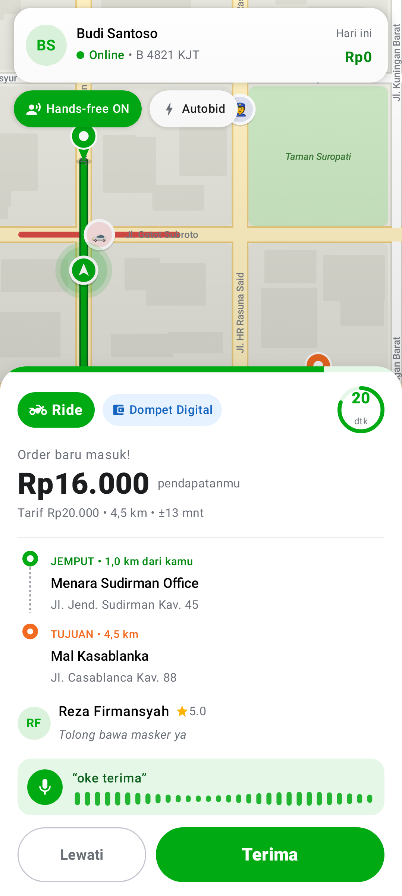
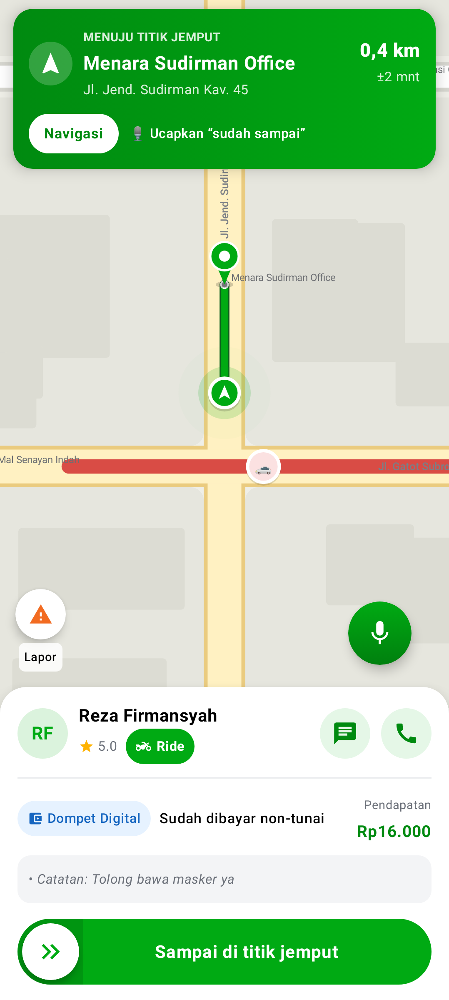
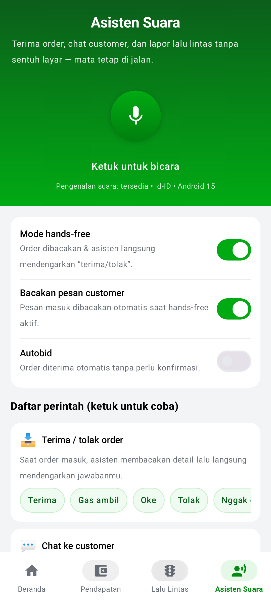
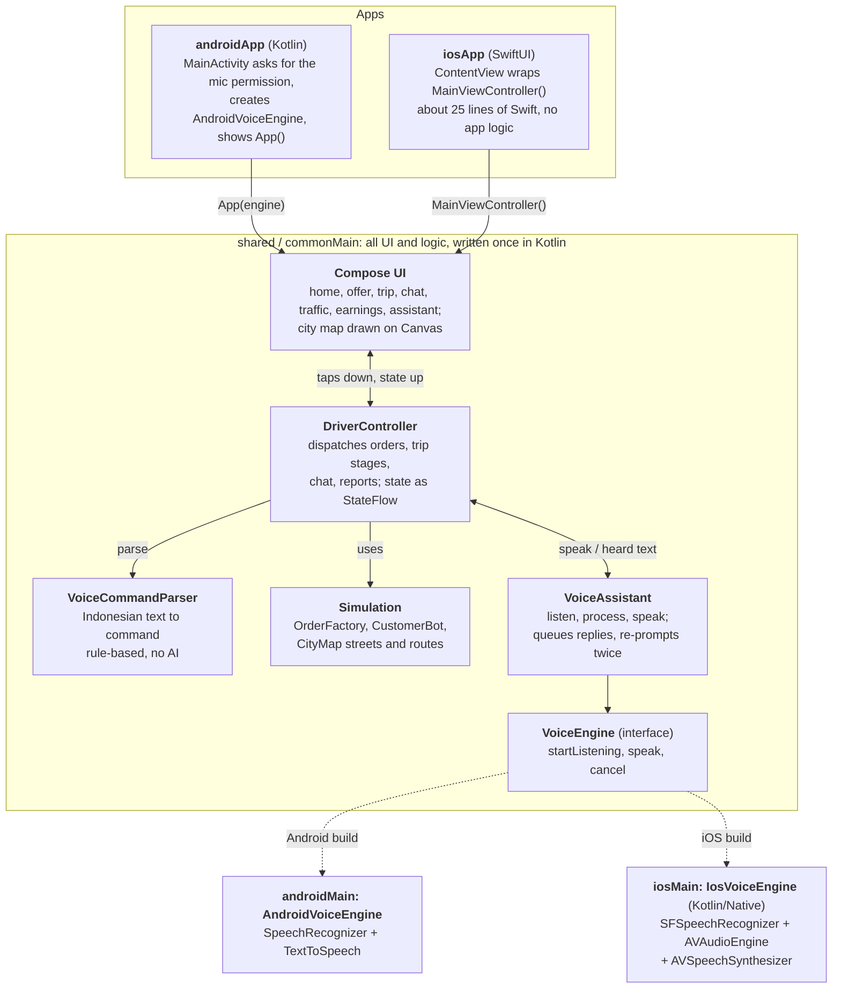
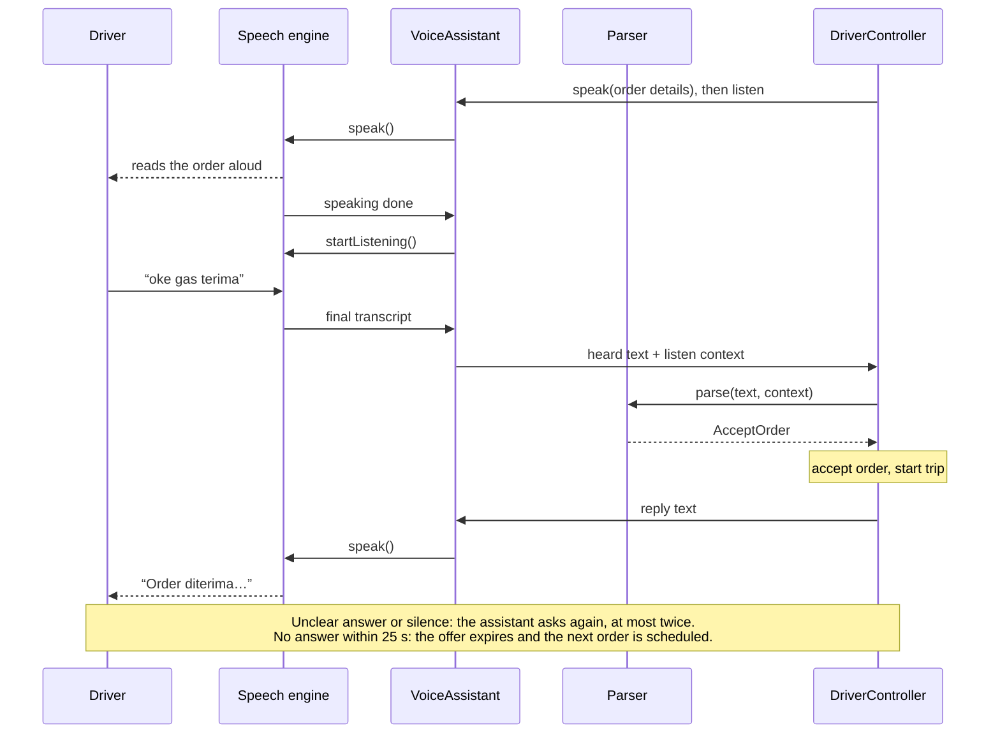
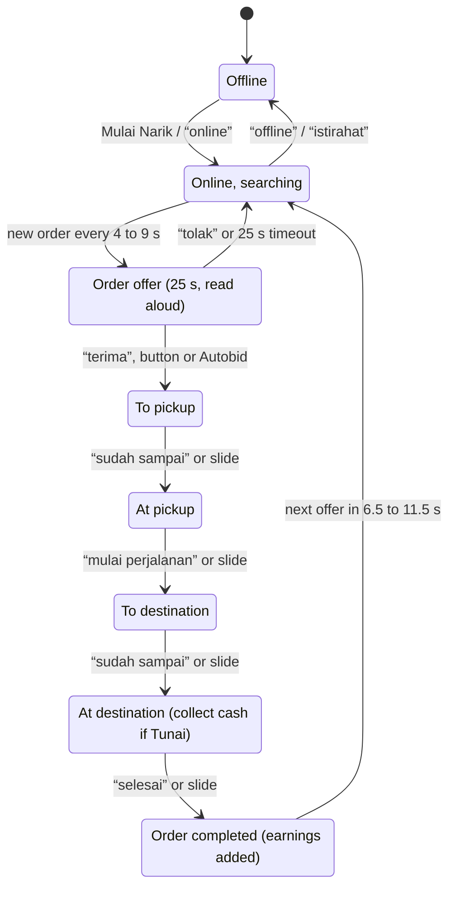

# Ojol Mitra: Technical Guide

Ojol Mitra is a Kotlin Multiplatform prototype of a ride-hailing driver app for Android and iOS. One shared Kotlin codebase holds the UI, the order simulation and the voice assistant, and every library it uses is free and open source.

> The design is inspired by ojol (ojek online) driver apps: green theme, full-screen map, bottom-sheet order card, slide-to-confirm. It uses no third-party logos, brand names or assets. The name "Ojol Mitra", the icon, the map and all data are fictional.

| Home | Incoming order + voice | Trip | Voice panel |
|---|---|---|---|
|  |  |  |  |
| **Chat by voice** | **Traffic report by voice** | **Order completed** | **Voice assistant tab** |
|  |  |  |  |

Screenshots are generated by the Android end-to-end UI test (Robolectric + Roborazzi).

**Contents:** [Features](#features) · [Architecture](#architecture) · [Third-party libraries and cost](#third-party-libraries-and-cost) · [Platform services and running costs](#platform-services-and-running-costs) · [Voice command flow](#voice-command-flow) · [Order and trip flow](#order-and-trip-flow) · [Voice command reference](#voice-command-reference) · [How to](#how-to) · [Troubleshooting](#troubleshooting) · [Verification status and limitations](#verification-status-and-limitations)

## Features

- **Driver simulation:** go online with "Mulai Narik"; random Ride, Food and Send orders arrive every 4 to 9 s, each with a 25 s countdown, earnings, fare, pickup and drop-off distance, customer, notes and payment method.
- **Trip:** the driver moves along the route on the map; remaining distance and ETA; slide-to-confirm for each stage (pickup, start trip, arrive, complete).
- **Chat** with a simulated customer who replies in context; simulated phone call.
- **Earnings and performance:** today's earnings, wallet (cash-order commission), acceptance, completion, rating, trip history; **Autobid** accepts orders automatically.
- **Voice commands (Indonesian):** accept or reject orders, send chat to the customer, report traffic, move through trip stages, all hands-free. See the [voice command reference](#voice-command-reference).
- **Typing mode** in the voice panel for emulators and simulators without a microphone.

## Architecture

The app uses Kotlin Multiplatform with Compose Multiplatform: about 90% of the code (5,425 of about 6,100 lines) sits in one shared module, and only the speech engines are written per platform.



Read it top down: each app only creates its voice engine and shows `App()`; everything else is shared, and the controller talks to speech only through the `VoiceEngine` interface.

- **State:** `DriverController` exposes two `StateFlow`s. One holds orders, trip, chat, reports and earnings; the other holds the driver's position, updated 25 times a second so only the map redraws.
- **Threading:** controller code and all engine callbacks run on the main thread. Coroutine `delay`s drive timers, offer countdowns and driver movement.
- **Native code:** the iOS engine is Kotlin/Native calling Apple's Speech and AVFAudio APIs directly, so the Swift side is a thin wrapper.
- **Map:** `CityMap` is a fictional street grid with shortest-path routing between intersections, drawn on a Compose Canvas instead of a map SDK.
- **Folders:** `shared/src/commonMain` (UI, logic), `androidMain` and `iosMain` (voice engines), `commonTest` (unit tests), `androidApp`, `iosApp`.

```
.
├── shared/src/
│   ├── commonMain/kotlin/id/ojolmitra/driver/
│   │   ├── core/      DriverController, DriverState, SimTiming
│   │   ├── voice/     VoiceCommandParser, VoiceAssistant, VoiceEngine, Speech
│   │   ├── sim/       OrderFactory, CustomerBot
│   │   ├── map/       CityMap
│   │   └── ui/        screens/, components/, theme/
│   ├── androidMain/   AndroidVoiceEngine, platform helpers
│   ├── iosMain/       IosVoiceEngine, MainViewController
│   └── commonTest/    parser, map and controller tests
├── androidApp/        MainActivity + Robolectric UI test
└── iosApp/            Xcode project (SwiftUI wrapper)
```

## Third-party libraries and cost

Every library is free and open source, so the license cost is US$0. The app needs no API keys, SDK accounts or paid services. Test-only libraries are not shipped in the app.

| Library | Version | Used for | Scope | License | Cost |
| --- | --- | --- | --- | --- | --- |
| Kotlin (Multiplatform plugin, Compose compiler plugin) | 2.4.21 | Language, compiler, shared Android + iOS code | App | Apache 2.0 | Free |
| Compose Multiplatform (runtime, foundation, ui) | 1.11.1 | One UI for Android and iOS | App | Apache 2.0 | Free |
| Compose Material 3 (multiplatform) | 1.9.0 | Buttons, bottom sheet, switches, navigation bar | App | Apache 2.0 | Free |
| Material Icons Extended | 1.7.3 | Icons (mic, motorbike, wallet, traffic light) | App | Apache 2.0 | Free |
| kotlinx.coroutines (core, android) | 1.11.0 | Simulation timers, driver movement, StateFlow state | App | Apache 2.0 | Free |
| AndroidX Activity Compose | 1.13.0 | Android entry point, microphone permission request | App (Android) | Apache 2.0 | Free |
| Android Gradle Plugin | 8.13.2 | Android build | Build | Apache 2.0 | Free |
| Gradle (wrapper) | 8.14.7 | Build tool | Build | Apache 2.0 | Free |
| Android SDK (platform 36, build-tools 36) | 36 | Compile target | Build | Android SDK License Agreement | Free |
| kotlin-test | 2.4.21 | Unit test assertions | Test | Apache 2.0 | Free |
| kotlinx-coroutines-test | 1.11.0 | Virtual time in controller tests | Test | Apache 2.0 | Free |
| JUnit 4 | 4.13.2 | Android test runner | Test | EPL 1.0 | Free |
| Robolectric | 4.18 | Runs the Android framework on the JVM | Test | MIT | Free |
| Roborazzi | 1.79.0 | Screenshots from Robolectric tests | Test | Apache 2.0 | Free |
| AndroidX Compose UI Test | 1.11.2 | Clicks and assertions on the UI in tests | Test | Apache 2.0 | Free |

Versions are pinned in `gradle/libs.versions.toml`. Compose Multiplatform stays on 1.11.1 because 1.12 needs compileSdk 37, which AGP 8.13 does not support.

## Platform services and running costs

Running the prototype costs nothing: speech recognition, text-to-speech and the map all use free platform features, and there is no backend. Publishing to the stores adds developer-account fees.

| Service | Platform | Used for | Cost | Limits and notes |
| --- | --- | --- | --- | --- |
| `SpeechRecognizer` (android.speech) | Android | Speech to text | Free, no API key | Google's docs say it "is likely to stream audio to remote servers" and is not meant for continuous listening. No numeric quota is published; a `TOO_MANY_REQUESTS` error exists. The on-device variant (API 31+) is not used yet. [source](https://developer.android.com/reference/android/speech/SpeechRecognizer) |
| `TextToSpeech` | Android | Assistant's spoken replies | Free | Runs on the phone's TTS engine. Without Indonesian voice data it falls back to the device language. |
| Speech framework (`SFSpeechRecognizer` + `AVAudioEngine`) | iOS | Speech to text | Free, no API key | Apple throttles requests per device and per app and caps each request at about 1 minute (approximate, not checked against Apple's page). Server-based by default; on-device mode is not forced. |
| `AVSpeechSynthesizer` | iOS | Assistant's spoken replies | Free | Runs on the device. |
| City map | Both | Map, routes, traffic markers | US$0 | Drawn with Compose Canvas: no Google Maps or MapKit, no key, no per-load billing. |
| Backend | None | Orders, customers, reports | US$0 | Everything is simulated on the device. |

**Developer accounts (only for distribution):**

- **Apple Developer Program: US$99 per year**, needed for TestFlight and the App Store ([source](https://developer.apple.com/programs/)). A free Apple Account can still run the app on your own iPhone as a Personal Team: up to 3 devices and 3 apps per device, with provisioning that expires after 7 days ([source](https://developer.apple.com/support/compare-memberships/)).
- **Google Play Console: one-time registration fee of about US$25** (approximate; Google's fee page could not be opened). Not needed to install the APK directly on a phone.

Optional upgrades, such as a wake-word engine or an LLM for free-form commands, are paid per usage or per seat. Check current pricing before adopting one.

## Voice command flow

Every voice command takes the same path: the platform engine turns speech into text, the shared parser turns text into a command, and the controller acts and answers aloud.



The diagram shows the hands-free case; a tap on the mic skips the first four steps and starts at `startListening()`. The listen context tells the parser what is on screen: with an offer showing, "oke" or "ya" accept it, and after "Mau kirim pesan apa?" the whole sentence becomes the chat message.

## Order and trip flow

Every trip runs the same loop, and each step has both a voice phrase and a button.



Going offline is refused while a trip is active. Autobid accepts an offer 1.5 s after it appears. Saying "selesai" while still driving to the destination arrives and completes in one step.

## Voice command reference

Commands are spoken in Indonesian. The microphone turns on when the driver taps a mic button, or automatically in hands-free mode (new order, a question from the assistant, arrival at pickup or destination). There is no wake word yet.

| Intent | Example phrases | Works when | Result |
| --- | --- | --- | --- |
| Accept order | "terima", "ambil", "gas", "sikat"; "oke" / "ya" only while an offer shows | Offer on screen | Trip starts, driver heads to pickup |
| Reject order | "tolak", "lewati", "skip", "nggak dulu", "jangan ambil", "tidak mau" | Offer on screen | Offer closes, next offer is scheduled |
| Repeat details | "ulangi", "detail order" | Offer or trip | Reads the offer or trip status again |
| Send chat | "chat saya sudah di depan", "kirim pesan ke penumpang bahwa saya kena macet", "bilang ke customer tunggu 5 menit", "balas oke siap" | Active trip | Message sent and marked "via suara" |
| Chat in two steps | "kirim pesan" or "chat", then the message | Active trip | Assistant asks "Mau kirim pesan apa?" and listens |
| Read / call / open chat | "baca pesan", "telepon penumpang", "buka chat" | Active trip | Reads last message, simulated call, opens chat |
| Report traffic | "lapor macet parah di Jalan Sudirman", "ada kecelakaan di depan", "lapor banjir di Kemang Raya", "jalan ditutup dekat Stasiun Dukuh Atas", "info razia di Gatot Subroto" | Any time | Report with type, severity and location; marker on the map |
| Ask what to report | "lapor" | Any time | Assistant asks "Mau lapor apa?" |
| Trip stages | "sudah sampai", "penumpang sudah naik" / "makanan sudah diambil", "selesaikan order", "lanjut" | Active trip | Moves to the next stage |
| Navigation | "buka navigasi" | Active trip | Simulated navigation and remaining distance |
| Online / offline | "mulai narik", "online"; "offline", "istirahat" | Any time (offline is refused during a trip) | Changes driver status |
| Autobid | "nyalakan autobid", "matikan autobid" | Any time | Orders are accepted automatically or not |
| Earnings | "pendapatan hari ini" | Any time | Reads today's earnings and wallet balance |
| Help / cancel | "bantuan", "batal" | Any time | Lists commands for the current screen / stops |

Parser rules worth knowing:

- Fillers at the start ("halo", "mitra", "tolong") and at the end ("dong", "ya", "pak") are ignored.
- Slang maps to standard words: "udah sampe" means "sudah sampai", "gak" means "tidak".
- "Terima kasih" never accepts an order, and a negation before an accept word ("tidak mau") rejects.
- Location is the text after "di", "dekat", "depan" or "arah". No location, or "di depan" / "di sini", means the road the driver is on.
- Severity: "parah", "total" or "banget" mean Parah; "ringan" or "sedikit" mean Ringan; otherwise Sedang.
- During an offer, an unclear answer or silence is re-prompted up to 2 times before the 25-second timer runs out.

## How to

### Prerequisites

- JDK 17 or newer (the JDK bundled with Android Studio works).
- Android Studio, recent release, with Android SDK platform 36.
- For iOS: a Mac with Apple Silicon and Xcode 16 or newer. Intel Mac simulators are not supported, because Compose Multiplatform 1.11+ dropped the `iosX64` target.

### Run on Android

1. Clone this repo and open the folder in Android Studio. This also creates `local.properties` with your SDK path.
2. Pick the `androidApp` run configuration and a device, then Run. From a terminal:
   ```bash
   ./gradlew :androidApp:installDebug
   ```
3. Allow the microphone when asked. On an emulator without Google speech services, tap the keyboard icon in the voice panel and type commands instead.

### Run on iOS

1. Open the project once in Android Studio, or set `ANDROID_HOME`. The `shared` module also targets Android, so Gradle needs the SDK path even for iOS builds.
2. Open `iosApp/iosApp.xcodeproj` in Xcode.
3. Pick an iPhone simulator and Run. The "Compile Kotlin Framework" build phase runs `./gradlew :shared:embedAndSignAppleFrameworkForXcode` for you.
4. On a real iPhone, set Signing & Capabilities > Team (a free Personal Team works) and change the bundle id `id.ojolmitra.driver` if Xcode reports it is taken.
5. Allow Microphone and Speech Recognition when asked.

### Run the tests

```bash
./gradlew :shared:testDebugUnitTest            # 27 unit tests: parser, map routing, controller flow
./gradlew :androidApp:testDebugUnitTest        # end-to-end UI journey on Robolectric, screenshots in androidApp/screenshots/
./gradlew :shared:compileKotlinIosSimulatorArm64   # type-checks all iOS Kotlin code (also works on Linux and Windows)
```

### Add a voice command

1. Add a subtype to `VoiceCommand` in `shared/src/commonMain/kotlin/id/ojolmitra/driver/voice/VoiceCommand.kt`.
2. In `VoiceCommandParser.kt`, add a keyword list and a `hasAny(...)` branch in `parse()`. Put slang spellings in `ALIASES`.
3. Handle the new subtype in `DriverController.execute()` and return the spoken reply with `ok(...)` or `fail(...)`.
4. Add phrases to `VoiceCommandParserTest.kt` and run the unit tests.
5. Optional: add an example chip to `COMMAND_GROUPS` in `VoiceScreen.kt` and to `voiceSuggestions()` in `DriverApp.kt`.

### Tune the simulation

- Timing lives in `SimTiming` (`core/DriverState.kt`): offer every 4 to 9 s, 25 s offer countdown, each trip leg at most about 18 s, customer replies after 2.5 to 4.5 s, a community traffic report every 45 to 65 s.
- Fares live in `sim/OrderFactory.kt`: Ride Rp9.000 + Rp2.500/km, Food Rp8.000 + Rp2.400/km, Send Rp10.000 + Rp2.600/km, minimum Rp10.000. The driver earns 80% of the fare, plus a Rp2.000 bonus on 25% of orders.
- Roads, places, parks and the river live in `map/CityMap.kt`.

### Change the language or swap the voice engine

- The language tag is `VOICE_LANGUAGE = "id-ID"` in `voice/VoiceEngine.kt`. The parser's vocabulary is Indonesian, so another language also needs new keyword lists.
- To use another speech service, implement the `VoiceEngine` interface and pass it to `App(voiceEngine)` from `MainActivity` (Android) or `MainViewController()` (iOS). Deliver callbacks on the main thread, and send exactly one final event per listening session: a result, an error, or an end without result.

## Troubleshooting

Most first-run problems come from the iOS build calling Gradle, or from missing speech services or permissions on the device.

| Symptom | Cause | Fix |
| --- | --- | --- |
| Xcode build phase "Compile Kotlin Framework" fails with "SDK location not found" | The `shared` module also targets Android, so Gradle needs the Android SDK path | Open the project once in Android Studio, or `export ANDROID_HOME=~/Library/Android/sdk` |
| Xcode build phase: "Unable to locate a Java Runtime" | Xcode's shell does not inherit `JAVA_HOME` | The script falls back to Android Studio's bundled JDK in `/Applications`; otherwise install JDK 17+ or set `JAVA_HOME` in the build phase |
| Xcode: "Sandbox: deny file-read" during the Kotlin build phase | User script sandboxing is on | Keep `ENABLE_USER_SCRIPT_SANDBOXING = NO` (already set in the project) |
| Link error: undefined symbol `SFSpeechRecognizer` or `AVSpeechSynthesizer` | Speech or AVFoundation not linked | Keep `-framework Speech -framework AVFoundation` in Other Linker Flags (already set) |
| iOS app stops at launch with a message about `CADisableMinimumFrameDurationOnPhone` | Compose Multiplatform checks this Info.plist key | Keep the key in `iosApp/iosApp/Info.plist` if you replace that file |
| Voice panel says speech recognition is not available | Emulator or phone has no speech service (common on Android emulators without Google apps) | Use a phone with the Google app, or type commands via the keyboard icon |
| Mic button does nothing or a permission message appears | Microphone (and on iOS, Speech Recognition) permission was denied | Allow them in the system Settings for Ojol Mitra |
| Assistant speaks with a foreign accent | No Indonesian TTS voice installed | Android: Settings > Text-to-speech > install Indonesian. iOS: Settings > Accessibility > Spoken Content > Voices > Indonesian |
| Android build: dependency "requires compileSdk 37" | Compose Multiplatform was upgraded to 1.12+ | Stay on 1.11.x, or move to AGP 9 with compileSdk 37 |
| No iOS simulator target on an Intel Mac | `iosX64` is not built | Use an Apple Silicon Mac or a real iPhone |
| iOS stops listening too early or too late | Silence detection ends a request 1.3 s after the last new word (7 s with no speech) | Tune `scheduleEndOfSpeech` in `IosVoiceEngine.kt` |

## Verification status and limitations

The Android build and all shared logic are tested. The iOS Kotlin code compiles, but the iOS app has not yet been linked or launched, because that needs a Mac with Xcode.

| Check | Result | How it was checked |
| --- | --- | --- |
| Shared unit tests (27) | Pass | `./gradlew :shared:testDebugUnitTest` |
| Android debug APK | Pass | `./gradlew :androidApp:assembleDebug` (about 18 MB) |
| Android end-to-end UI journey | Pass, 3 runs in a row | Robolectric + Roborazzi: online, offer, accept by voice, chat by voice, traffic report by voice and by form, trip stages, completion, other tabs |
| iOS Kotlin compile (iosArm64, iosSimulatorArm64, iOS tests) | Pass | Kotlin 2.4 compiler, including the Speech and AVFAudio calls |
| Xcode project file | Structure valid | Parsed with a pbxproj parser; all references resolve. Not opened in Xcode |
| iOS link, launch and speech on device | Not verified | Needs a Mac with Xcode |
| Real microphone recognition on Android | Not verified | Tests inject transcripts; no emulator was available |

Limitations of the prototype:

- Orders, customers, chat replies and other drivers' reports are simulated on the device. There is no backend, login or payment.
- The map is a fictional street grid, not GPS or real roads. Calls and navigation are simulated.
- There is no wake word. Google's docs say `SpeechRecognizer` is not meant for continuous listening, so a wake word needs a dedicated engine.
- The parser is rule-based: phrasing outside its vocabulary gets "perintah belum dikenali" (command not recognized).
- State is not saved: earnings and history reset when the app restarts.

Suggested next steps: run on a Mac and real phones; add a wake word; switch to on-device recognition (Android API 31+, iOS on-device mode) for offline use; replace the simulation with real maps and a backend.
