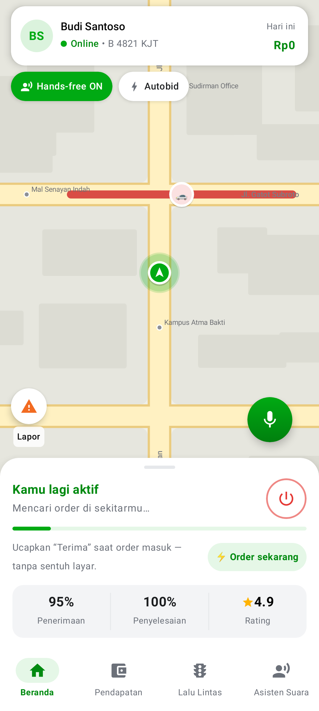
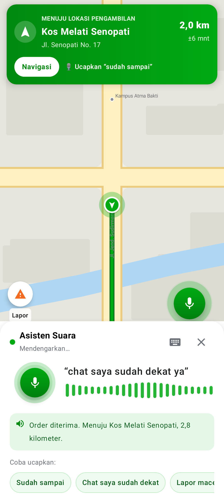
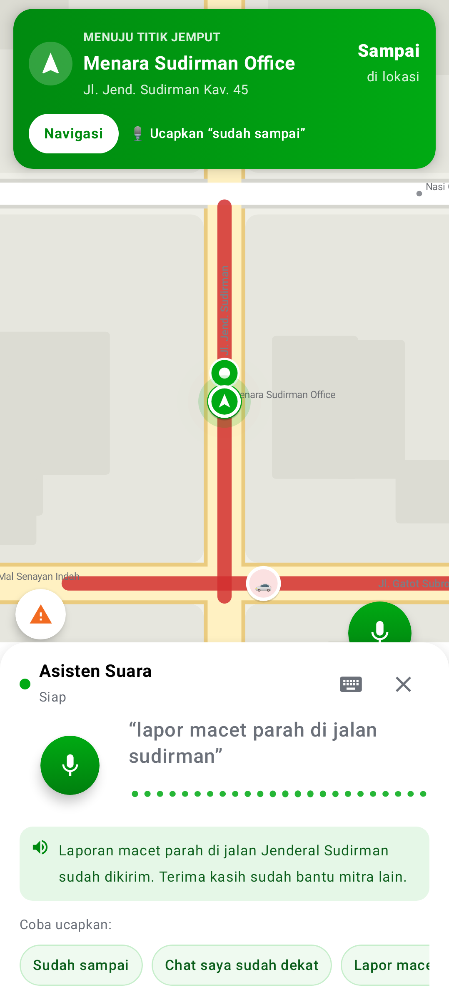
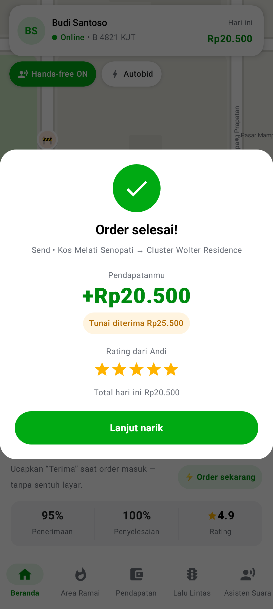
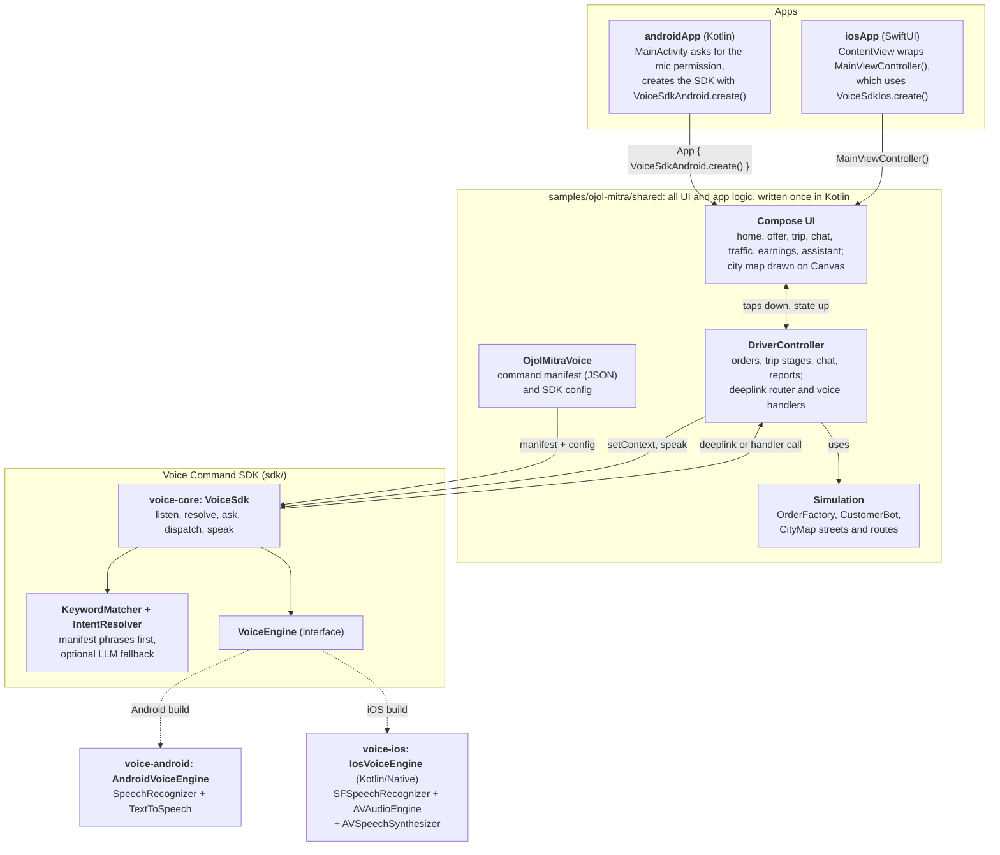
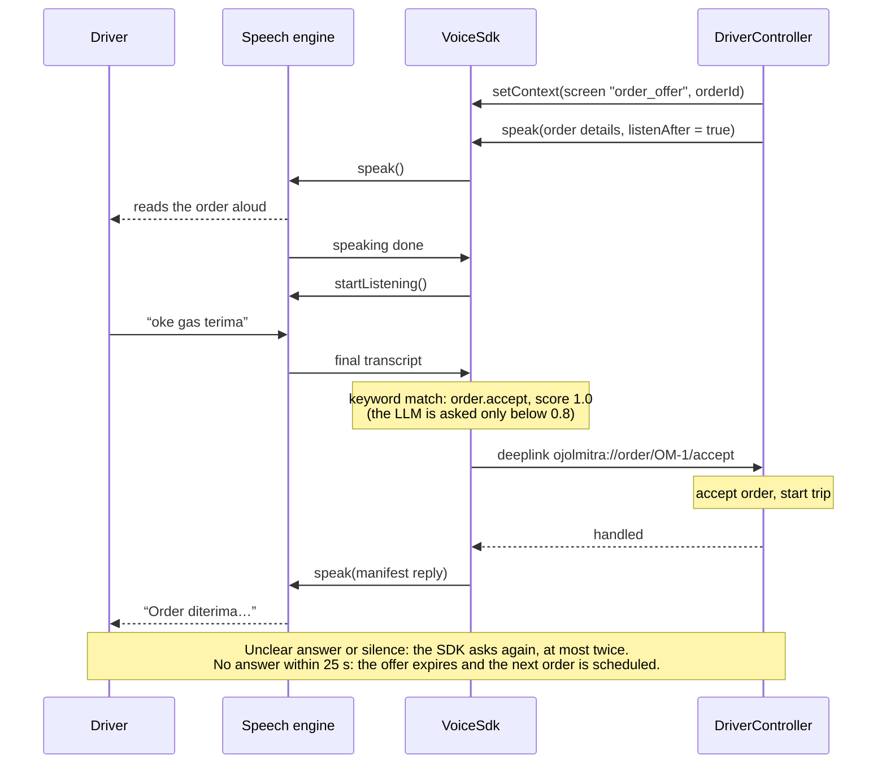
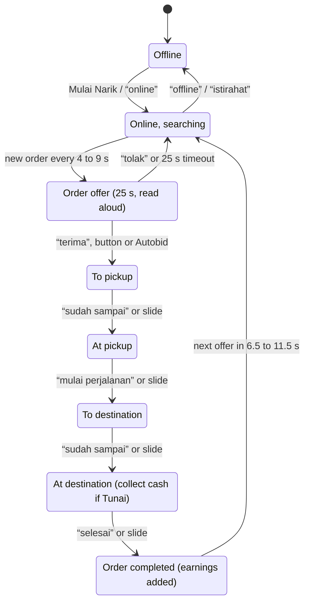
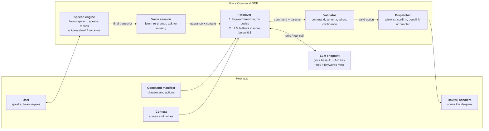
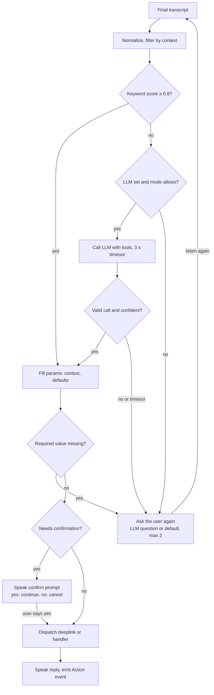

# asbun-sdk

This repository holds two things:

- **[Voice Command SDK](#voice-command-sdk)** (`sdk/`): a Kotlin Multiplatform library that turns speech into app actions on Android and iOS. An app lists its commands in a JSON manifest (phrases mapped to a deeplink or a handler), tells the SDK what is on screen, and can hand the phrasing that keywords miss to Claude (with an Anthropic API key) or to any LLM by URL and key.
- **[Ojol Mitra](#ojol-mitra-technical-guide)** (`samples/ojol-mitra/`): a ride-hailing driver app prototype, and the SDK's first consumer.

## Voice Command SDK

Version 1 of the [SDK plan](#voice-command-sdk-plan) is implemented: manifest, on-device keyword matcher, LLM fallback over three protocols, validation, context, deeplink allowlist, confirmation, slot filling, handlers, and the Android and iOS speech engines. Not done yet: publishing to Maven and Swift Package Manager, and a run on a Mac (the iOS code compiles, but has not been linked or launched).

| Module | Contents |
| --- | --- |
| `sdk/voice-core` | `VoiceSdk` (listen, resolve, ask, dispatch, speak), `CommandManifest`, `KeywordMatcher`, `IntentResolver`, `HttpLlmClient`, `Deeplinks`, and the `VoiceEngine` interface. Kotlin Multiplatform: Android and iOS. |
| `sdk/voice-android` | `AndroidVoiceEngine` (SpeechRecognizer + TextToSpeech), `AndroidLinkOpener`, `VoiceSdkAndroid.create(...)`. Declares `RECORD_AUDIO`. |
| `sdk/voice-ios` | `IosVoiceEngine` (SFSpeechRecognizer + AVAudioEngine + AVSpeechSynthesizer), `IosLinkOpener`, `VoiceSdkIos.create(...)`. Builds `VoiceSdk.xcframework`. |

### Quick start

1. List your commands in a manifest. The full format is under [Command manifest](#command-manifest).

   ```json
   {
     "version": 1,
     "defaultLocale": "id-ID",
     "commands": [
       {
         "id": "order.accept",
         "description": "Accept the incoming order shown on screen.",
         "phrases": ["terima", "ambil", "gas"],
         "when": { "screen": "order_offer" },
         "params": [ { "name": "orderId", "from": "context", "required": true } ],
         "action": { "type": "deeplink", "url": "myapp://order/{orderId}/accept" },
         "reply": "Order diterima."
       }
     ]
   }
   ```

2. Create the SDK, route its deeplinks, tell it what is on screen, and listen. Android is shown; on iOS, call `VoiceSdkIos.create(config, manifest)` instead.

   ```kotlin
   val voice = VoiceSdkAndroid.create(
       context = this,
       config = VoiceConfig(
           locale = "id-ID",
           dispatch = DispatchConfig(allowedSchemes = listOf("myapp")),
           // Optional: Claude for free-form phrasing. Leave it out to stay fully on-device.
           llm = Claude.config(apiKey = BuildConfig.CLAUDE_API_KEY),
       ),
       manifest = CommandManifest.fromJson(assets.open("voice-commands.json").bufferedReader().readText()),
       requestPermission = { micPermission.launch(Manifest.permission.RECORD_AUDIO) },
   )
   voice.onDeeplink { url -> router.open(url); true }   // true = handled in the app
   voice.setContext(VoiceContext(screen = "order_offer", values = mapOf("orderId" to "OM-1")))
   micButton.setOnClickListener { voice.startListening() }
   ```

3. Draw your voice UI from `voice.state` (a `StateFlow`) and `voice.events`, or from `voice.addEventListener { }`, which calls back synchronously and is the easiest option from Swift. Call `voice.close()` when you are done; it releases the microphone and text-to-speech.

The Ojol Mitra sample uses every feature: [`OjolMitraVoice.kt`](samples/ojol-mitra/shared/src/commonMain/kotlin/id/ojolmitra/driver/voice/OjolMitraVoice.kt) holds its 23-command manifest, and [`DriverController.kt`](samples/ojol-mitra/shared/src/commonMain/kotlin/id/ojolmitra/driver/core/DriverController.kt) its deeplink router, handlers and context.

### Claude

`Claude.config(apiKey)` connects the SDK to the Claude API (Anthropic Messages API) with the settings below. Keyword matching still runs first on the device; Claude only sees what the keywords miss (`KEYWORD_FIRST`).

```kotlin
VoiceConfig(locale = "id-ID", llm = Claude.config(apiKey = "sk-ant-..."))
// Another model, more thinking, a proxy that holds the key, or token accounting:
Claude.config(
    model = "claude-haiku-5-5",
    effort = "medium",
    baseUrl = "https://llm-proxy.example.com",
    tokenProvider = { api.voiceToken() },
    onUsage = { usage -> metrics.record(usage.inputTokens, usage.outputTokens, usage.cacheReadInputTokens) },
)
```

| Setting | Default | Why |
| --- | --- | --- |
| `model` | `Claude.DEFAULT_MODEL` (Claude Opus 5.5) | Any Claude model id works; a smaller model trades capability for price and speed |
| `effort` | `low` | Sent as `output_config.effort`. Current models always think; picking one command for one sentence needs little of it |
| `timeoutMs` | 6000 | Thinking takes longer than a plain HTTP round trip. On timeout the user hears "not understood" |
| `maxTokens` | 4096 | A ceiling, not a target: thinking counts toward it, and you pay only for what is used |
| `refusalFallback` | on for models that support it | Sends `fallbacks: "default"` (beta `server-side-fallback-2026-07-01`): if a safety classifier declines, the API retries on the model Anthropic recommends, in the same call. Turn it off when `baseUrl` is a proxy to Bedrock, Vertex AI or Foundry |
| `promptCaching` | on | One `cache_control` breakpoint covers the tools and system prompt; the screen data and transcript come after it. Cache reads bill at a tenth of the input price, and the cache is shared by every user of the app on the same screen |
| `onUsage` | not set | Token counts per call, including cache reads and whether a fallback model answered |

Errors come back as `LlmException` with `httpStatus` and the API's `errorType` (for example `authentication_error` for a wrong key). One retry happens inside the timeout for overloads, server errors and rate limits that send `retry-after`; a 429 without it, a spend cap, is not retried. Calling the Claude API without a key fails at once, before any request.

**Keys:** a key built into an APK or IPA can be extracted. Use `apiKey` for development and internal builds; in production, point `baseUrl` at your own proxy that holds the key, or fetch short-lived tokens with `tokenProvider`.

### Build and test the SDK

```bash
./gradlew :sdk:voice-core:testDebugUnitTest            # 56 unit tests: manifest, matcher, deeplinks, Claude and the other LLM protocols on a mock server, resolver, dialog
./gradlew :sdk:voice-android:assembleRelease           # Android library (AAR)
./gradlew :sdk:voice-ios:compileKotlinIosArm64         # type-checks the iOS engine; works on Linux and Windows too
./gradlew :sdk:voice-ios:assembleVoiceSdkXCFramework   # VoiceSdk.xcframework; needs a Mac with Xcode
```

# Ojol Mitra: Technical Guide

Ojol Mitra is a Kotlin Multiplatform prototype of a ride-hailing driver app for Android and iOS. One shared Kotlin codebase holds the UI and the order simulation, voice commands run on the Voice Command SDK from this repository, and every library it uses is free and open source.

> The design is inspired by ojol (ojek online) driver apps: green theme, full-screen map, bottom-sheet order card, slide-to-confirm. It uses no third-party logos, brand names or assets. The name "Ojol Mitra", the icon, the map and all data are fictional.

| Home | Incoming order + voice | Trip | Voice panel |
|---|---|---|---|
|  |  |  |  |
| **Chat by voice** | **Traffic report by voice** | **Order completed** | **Voice assistant tab** |
|  |  |  |  |

Screenshots are generated by the Android end-to-end UI test (Robolectric + Roborazzi).

**Contents:** [Features](#features) · [Architecture](#architecture) · [Third-party libraries and cost](#third-party-libraries-and-cost) · [Platform services and running costs](#platform-services-and-running-costs) · [Voice command flow](#voice-command-flow) · [Order and trip flow](#order-and-trip-flow) · [Voice command reference](#voice-command-reference) · [How to](#how-to) · [Troubleshooting](#troubleshooting) · [Verification status and limitations](#verification-status-and-limitations) · [Voice Command SDK plan](#voice-command-sdk-plan)

## Features

- **Driver simulation:** go online with "Mulai Narik"; random Ride, Food and Send orders arrive every 4 to 9 s, each with a 25 s countdown, earnings, fare, pickup and drop-off distance, customer, notes and payment method.
- **Trip:** the driver moves along the route on the map; remaining distance and ETA; slide-to-confirm for each stage (pickup, start trip, arrive, complete).
- **Chat** with a simulated customer who replies in context; simulated phone call.
- **Earnings and performance:** today's earnings, wallet (cash-order commission), acceptance, completion, rating, trip history; **Autobid** accepts orders automatically.
- **Voice commands (Indonesian):** accept or reject orders, send chat to the customer, report traffic, move through trip stages, all hands-free, through the Voice Command SDK with an optional LLM fallback. See the [voice command reference](#voice-command-reference).
- **Typing mode** in the voice panel for emulators and simulators without a microphone.

## Architecture

The app uses Kotlin Multiplatform with Compose Multiplatform. All UI and app logic (about 5,300 lines) sits in one shared module; speech lives in the SDK's platform modules, so each app only creates the SDK and shows `App()`.



Read it top down: each app only creates the SDK with its platform's engine and shows `App()`; the controller never touches speech directly. It tells the SDK what is on screen, and the SDK calls back with a deeplink or a handler call once it has understood a command.

- **State:** `DriverController` exposes two `StateFlow`s. One holds orders, trip, chat, reports and earnings; the other holds the driver's position, updated 25 times a second so only the map redraws. The voice UI combines the SDK's `state` with `VoicePanel` (panel, dictation, history).
- **Threading:** controller code, SDK callbacks and all engine callbacks run on the main thread. Coroutine `delay`s drive timers, offer countdowns and driver movement.
- **Native code:** the iOS engine is Kotlin/Native calling Apple's Speech and AVFAudio APIs directly, so the Swift side is a thin wrapper.
- **Map:** `CityMap` is a fictional street grid with shortest-path routing between intersections, drawn on a Compose Canvas instead of a map SDK.

```
.
├── sdk/
│   ├── voice-core/        VoiceSdk, CommandManifest, KeywordMatcher, IntentResolver, HttpLlmClient, Deeplinks
│   ├── voice-android/     AndroidVoiceEngine, AndroidLinkOpener, VoiceSdkAndroid
│   └── voice-ios/         IosVoiceEngine, IosLinkOpener, VoiceSdkIos
└── samples/ojol-mitra/
    ├── shared/src/
    │   ├── commonMain/kotlin/id/ojolmitra/driver/
    │   │   ├── core/      DriverController (router, voice handlers, context), DriverState, SimTiming
    │   │   ├── voice/     OjolMitraVoice (manifest, config), VoicePanel, Speech
    │   │   ├── sim/       OrderFactory, CustomerBot
    │   │   ├── map/       CityMap
    │   │   └── ui/        screens/, components/, theme/
    │   ├── iosMain/       MainViewController
    │   └── commonTest/    manifest, map and controller tests
    ├── androidApp/        MainActivity + Robolectric UI test
    └── iosApp/            Xcode project (SwiftUI wrapper)
```

## Third-party libraries and cost

Every library is free and open source, so the license cost is US$0. The app needs no API keys, SDK accounts or paid services, unless you turn on the optional LLM fallback, which your LLM provider bills per use (see [Security, privacy and cost](#security-privacy-and-cost)). Test-only libraries are not shipped in the app.

| Library | Version | Used for | Scope | License | Cost |
| --- | --- | --- | --- | --- | --- |
| Kotlin (Multiplatform plugin, Compose compiler plugin) | 2.4.21 | Language, compiler, shared Android + iOS code | App | Apache 2.0 | Free |
| Compose Multiplatform (runtime, foundation, ui) | 1.11.1 | One UI for Android and iOS | App | Apache 2.0 | Free |
| Compose Material 3 (multiplatform) | 1.9.0 | Buttons, bottom sheet, switches, navigation bar | App | Apache 2.0 | Free |
| Material Icons Extended | 1.7.3 | Icons (mic, motorbike, wallet, traffic light) | App | Apache 2.0 | Free |
| kotlinx.coroutines (core, android) | 1.11.0 | Simulation timers, driver movement, StateFlow state | App | Apache 2.0 | Free |
| AndroidX Activity Compose | 1.13.0 | Android entry point, microphone permission request | App (Android) | Apache 2.0 | Free |
| kotlinx.serialization (JSON) | 1.13.0 | Reads the manifest and config, builds LLM requests | SDK | Apache 2.0 | Free |
| Ktor client (core, Android engine, Darwin engine) | 3.6.1 | HTTP calls to the optional LLM | SDK | Apache 2.0 | Free |
| Android Gradle Plugin | 8.13.2 | Android build | Build | Apache 2.0 | Free |
| Gradle (wrapper) | 8.14.7 | Build tool | Build | Apache 2.0 | Free |
| Android SDK (platform 36, build-tools 36) | 36 | Compile target | Build | Android SDK License Agreement | Free |
| kotlin-test | 2.4.21 | Unit test assertions | Test | Apache 2.0 | Free |
| kotlinx-coroutines-test | 1.11.0 | Virtual time in controller tests | Test | Apache 2.0 | Free |
| Ktor client mock | 3.6.1 | Fake LLM server in SDK tests | Test | Apache 2.0 | Free |
| JUnit 4 | 4.13.2 | Android test runner | Test | EPL 1.0 | Free |
| Robolectric | 4.18 | Runs the Android framework on the JVM | Test | MIT | Free |
| Roborazzi | 1.79.0 | Screenshots from Robolectric tests | Test | Apache 2.0 | Free |
| AndroidX Compose UI Test | 1.11.2 | Clicks and assertions on the UI in tests | Test | Apache 2.0 | Free |

Versions are pinned in `gradle/libs.versions.toml`. Compose Multiplatform stays on 1.11.1 because 1.12 needs compileSdk 37, which AGP 8.13 does not support. For the same reason the SDK uses Ktor's Android engine (HttpURLConnection) instead of OkHttp, whose 5.x releases also need compileSdk 37.

## Platform services and running costs

Running the prototype costs nothing: speech recognition, text-to-speech and the map all use free platform features, and there is no backend. Publishing to the stores adds developer-account fees.

| Service | Platform | Used for | Cost | Limits and notes |
| --- | --- | --- | --- | --- |
| `SpeechRecognizer` (android.speech) | Android | Speech to text | Free, no API key | Google's docs say it "is likely to stream audio to remote servers" and is not meant for continuous listening. No numeric quota is published; a `TOO_MANY_REQUESTS` error exists. The on-device variant (API 31+) is not used yet. [source](https://developer.android.com/reference/android/speech/SpeechRecognizer) |
| `TextToSpeech` | Android | Assistant's spoken replies | Free | Runs on the phone's TTS engine. Without Indonesian voice data it falls back to the device language. |
| Speech framework (`SFSpeechRecognizer` + `AVAudioEngine`) | iOS | Speech to text | Free, no API key | Apple throttles requests per device and per app and caps each request at about 1 minute (approximate, not checked against Apple's page). Server-based by default; on-device mode is not forced. |
| `AVSpeechSynthesizer` | iOS | Assistant's spoken replies | Free | Runs on the device. |
| City map | Both | Map, routes, traffic markers | US$0 | Drawn with Compose Canvas: no Google Maps or MapKit, no key, no per-load billing. |
| Backend | None | Orders, customers, reports | US$0 | Everything is simulated on the device. |
| Claude, or another LLM (optional) | Both | Phrasing the manifest's keywords miss | Per token, billed by Anthropic or your provider | Off unless configured; see [Turn on Claude](#turn-on-claude). |

**Developer accounts (only for distribution):**

- **Apple Developer Program: US$99 per year**, needed for TestFlight and the App Store ([source](https://developer.apple.com/programs/)). A free Apple Account can still run the app on your own iPhone as a Personal Team: up to 3 devices and 3 apps per device, with provisioning that expires after 7 days ([source](https://developer.apple.com/support/compare-memberships/)).
- **Google Play Console: one-time registration fee of about US$25** (approximate; Google's fee page could not be opened). Not needed to install the APK directly on a phone.

Optional upgrades, such as a wake-word engine, are paid per usage or per seat. Check current pricing before adopting one.

## Voice command flow

Every voice command takes the same path: the platform engine turns speech into text, the SDK matches the text against the manifest commands that the current screen allows, and the app acts through a deeplink or a handler while the SDK answers aloud.



The diagram shows the hands-free case; a tap on the mic skips the first five steps and starts at `startListening()`. The context tells the SDK what is on screen: the manifest's `when` conditions allow "oke" or "ya" to accept only while an offer shows, and after "Mau kirim pesan apa?" the SDK takes the whole next sentence as the chat message.

## Order and trip flow

Every trip runs the same loop, and each step has both a voice phrase and a button.



Going offline is refused while a trip is active. Autobid accepts an offer 1.5 s after it appears. Saying "selesai" while still driving to the destination arrives and completes in one step.

## Voice command reference

Commands are spoken in Indonesian. The microphone turns on when the driver taps a mic button, or automatically in hands-free mode (new order, a question from the assistant, arrival at pickup or destination). There is no wake word yet.

| Intent | Example phrases | Works when | Result |
| --- | --- | --- | --- |
| Accept order | "terima", "ambil", "gas", "sikat"; "oke" / "ya" only while an offer shows | Offer on screen | Trip starts, driver heads to pickup |
| Reject order | "tolak", "lewati", "skip", "nggak dulu", "jangan ambil", "tidak mau" | Offer on screen | Offer closes, next offer is scheduled |
| Repeat details | "ulangi", "detail order" | Offer or trip | Reads the offer or trip status again |
| Send chat | "chat saya sudah di depan", "kirim pesan ke penumpang bahwa saya kena macet", "bilang ke customer tunggu 5 menit", "balas oke siap" | Active trip | Message sent and marked "via suara" |
| Chat in two steps | "kirim pesan" or "chat", then the message | Active trip | Assistant asks "Mau kirim pesan apa?" and listens |
| Dictate chat | Tap the mic on the chat screen, then say the message | Chat screen open | The whole sentence is sent, even "terima kasih"; "batal" cancels |
| Read / call / open chat | "baca pesan", "telepon penumpang", "buka chat" | Active trip | Reads last message, simulated call, opens chat |
| Report traffic | "lapor macet parah di Jalan Sudirman", "ada kecelakaan di depan", "lapor banjir di Kemang Raya", "jalan ditutup dekat Stasiun Dukuh Atas", "info razia di Gatot Subroto" | Any time | Report with type, severity and location; marker on the map |
| Ask what to report | "lapor" | Any time | Assistant asks "Mau lapor apa?" |
| Trip stages | "sudah sampai", "penumpang sudah naik" / "makanan sudah diambil", "selesaikan order", "lanjut" | Active trip | Moves to the next stage |
| Navigation | "buka navigasi" | Active trip | Simulated navigation and remaining distance |
| Online / offline | "mulai narik", "online"; "offline", "istirahat" | Any time (offline is refused during a trip) | Changes driver status |
| Autobid | "nyalakan autobid", "matikan autobid" | Any time | Orders are accepted automatically or not |
| Earnings | "pendapatan hari ini" | Any time | Reads today's earnings and wallet balance |
| Help / cancel | "bantuan", "batal" | Any time | Lists commands for the current screen / stops |

Matching rules worth knowing (all set in the manifest, none in code):

- Fillers at the start or end ("halo", "mitra", "tolong", "dong", "ya", "pak") are ignored.
- Slang maps to standard words through `aliases`: "udah sampe" means "sudah sampai", "gak" means "tidak".
- A command runs only on the screens its `when` allows: "terima" with no offer showing, or "chat ..." with no trip, gets "perintah belum dikenali".
- The phrase must explain at least 80% of the sentence, so "apa ya tadi" does not accept an order, while "oke gas terima" does.
- "Terima kasih" never accepts an order (`notPhrases`), and "tidak mau" rejects.
- Location is the text after "di", "dekat", "depan", "arah" and similar words. No location, or "di depan" / "di sini", means the road the driver is on.
- Severity: "parah", "total" or "banget" mean Parah; "ringan" or "sedikit" mean Ringan; otherwise Sedang.
- After a question (a new order, "Mau lapor apa?"), an unclear answer or silence is re-prompted up to 2 times.

## How to

### Prerequisites

- JDK 17 or newer (the JDK bundled with Android Studio works).
- Android Studio, recent release, with Android SDK platform 36.
- For iOS: a Mac with Apple Silicon and Xcode 16 or newer. Intel Mac simulators are not supported, because Compose Multiplatform 1.11+ dropped the `iosX64` target.

### Run on Android

1. Clone this repo and open the folder in Android Studio. This also creates `local.properties` with your SDK path.
2. Pick the `androidApp` run configuration (module `samples/ojol-mitra/androidApp`) and a device, then Run. From a terminal:
   ```bash
   ./gradlew :samples:ojol-mitra:androidApp:installDebug
   ```
3. Allow the microphone when asked. On an emulator without Google speech services, tap the keyboard icon in the voice panel and type commands instead.

### Get the APK from CI

Every push that changes code runs the [Android APK workflow](.github/workflows/android-apk.yml) on GitHub Actions, which builds the debug APK. Open the run in the repository's **Actions** tab and download `ojol-mitra-debug-<commit>.apk` under **Artifacts**. Artifacts are kept for 14 days, and the workflow can also be started by hand with **Run workflow**.

### Run on iOS

1. Open the project once in Android Studio, or set `ANDROID_HOME`. The shared and SDK modules also target Android, so Gradle needs the SDK path even for iOS builds.
2. Open `samples/ojol-mitra/iosApp/iosApp.xcodeproj` in Xcode.
3. Pick an iPhone simulator and Run. The "Compile Kotlin Framework" build phase runs `./gradlew :samples:ojol-mitra:shared:embedAndSignAppleFrameworkForXcode` from the repository root for you.
4. On a real iPhone, set Signing & Capabilities > Team (a free Personal Team works) and change the bundle id `id.ojolmitra.driver` if Xcode reports it is taken.
5. Allow Microphone and Speech Recognition when asked.

### Run the tests

```bash
./gradlew :sdk:voice-core:testDebugUnitTest                         # 56 SDK unit tests
./gradlew :samples:ojol-mitra:shared:testDebugUnitTest              # 32 app tests: manifest phrases, map routing, controller flow by voice
./gradlew :samples:ojol-mitra:androidApp:testDebugUnitTest          # end-to-end UI journey on Robolectric, screenshots in samples/ojol-mitra/androidApp/screenshots/
./gradlew :samples:ojol-mitra:shared:compileKotlinIosSimulatorArm64 # type-checks the app's and the SDK's iOS Kotlin code (also works on Linux and Windows)
```

### Turn on Claude

Without an LLM, only the manifest's phrases are understood. With Claude, the SDK sends what the keywords miss to the Claude API, which picks one of the manifest's commands; the answer is validated before anything runs. Settings and defaults are under [Claude](#claude).

- **Android sample:** add your Anthropic API key to `local.properties` in the repository root (the file is git-ignored), then rebuild:
  ```properties
  voice.claude.apiKey=your-anthropic-api-key
  ```
  `voice.claude.model` picks another model; the default is `Claude.DEFAULT_MODEL`.
- **iOS sample:** pass `Claude.config(apiKey = "...")` to `OjolMitraVoice.config(llm = ...)` in `MainViewController.kt`.
- **Another provider:** set `voice.llm.baseUrl`, `voice.llm.model`, `voice.llm.protocol` (`OPENAI_COMPATIBLE` or `CUSTOM_JSON`) and `voice.llm.apiKey` instead.
- A key built into an app can be extracted from it, so keep these builds internal. For production, see [Security, privacy and cost](#security-privacy-and-cost).

### Add a voice command

1. Add an entry to `commands` in the manifest in `samples/ojol-mitra/shared/src/commonMain/kotlin/id/ojolmitra/driver/voice/OjolMitraVoice.kt`: `id`, `description` (the LLM reads it), `phrases` with `{slots}`, `when`, `params` and an `action`. Put slang spellings in `aliases`.
2. For a `deeplink` action, handle the new path in `DriverController.route()` and return true when it worked. For a `handler` action, register it in `registerVoiceHandlers()` and return `HandlerResult.success(reply)` or `HandlerResult.failure(reply)`.
3. If the command needs a value from the screen (an id, a name), add it in `syncVoiceContext()`.
4. Add phrases to `OjolMitraManifestTest.kt` and run the unit tests.
5. Optional: add an example chip to `COMMAND_GROUPS` in `VoiceScreen.kt` and to `voiceSuggestions()` in `DriverApp.kt`.

### Tune the simulation

- Timing lives in `SimTiming` (`core/DriverState.kt`): offer every 4 to 9 s, 25 s offer countdown, each trip leg at most about 18 s, customer replies after 2.5 to 4.5 s, a community traffic report every 45 to 65 s.
- Fares live in `sim/OrderFactory.kt`: Ride Rp9.000 + Rp2.500/km, Food Rp8.000 + Rp2.400/km, Send Rp10.000 + Rp2.600/km, minimum Rp10.000. The driver earns 80% of the fare, plus a Rp2.000 bonus on 25% of orders.
- Roads, places, parks and the river live in `map/CityMap.kt`.

### Change the language or swap the voice engine

- The language tag is `OjolMitraVoice.LOCALE = "id-ID"`. Manifest phrases, aliases and fillers are keyed by language (`{"id-ID": [...], "en-US": [...]}`), so another language needs its own phrase lists; `VoiceMessages.ENGLISH` covers the SDK's built-in replies.
- To use another speech service, implement the SDK's `VoiceEngine` interface and build the SDK with `VoiceSdk(config, manifest, engine, scope)` inside `App { scope -> ... }`. Deliver callbacks on the main thread, and send exactly one final event per listening session: a result, an error, or an end without result.

## Troubleshooting

Most first-run problems come from the iOS build calling Gradle, or from missing speech services or permissions on the device.

| Symptom | Cause | Fix |
| --- | --- | --- |
| Xcode build phase "Compile Kotlin Framework" fails with "SDK location not found" | The shared and SDK modules also target Android, so Gradle needs the Android SDK path | Open the project once in Android Studio, or `export ANDROID_HOME=~/Library/Android/sdk` |
| Xcode build phase: "Unable to locate a Java Runtime" | Xcode's shell does not inherit `JAVA_HOME` | The script falls back to Android Studio's bundled JDK in `/Applications`; otherwise install JDK 17+ or set `JAVA_HOME` in the build phase |
| Xcode: "Sandbox: deny file-read" during the Kotlin build phase | User script sandboxing is on | Keep `ENABLE_USER_SCRIPT_SANDBOXING = NO` (already set in the project) |
| Link error: undefined symbol `SFSpeechRecognizer` or `AVSpeechSynthesizer` | Speech or AVFoundation not linked | Keep `-framework Speech -framework AVFoundation` in Other Linker Flags (already set) |
| iOS app stops at launch with a message about `CADisableMinimumFrameDurationOnPhone` | Compose Multiplatform checks this Info.plist key | Keep the key in `samples/ojol-mitra/iosApp/iosApp/Info.plist` if you replace that file |
| Voice panel says speech recognition is not available | Emulator or phone has no speech service (common on Android emulators without Google apps) | Use a phone with the Google app, or type commands via the keyboard icon |
| Mic button does nothing or a permission message appears | Microphone (and on iOS, Speech Recognition) permission was denied | Allow them in the system Settings for Ojol Mitra |
| Assistant speaks with a foreign accent | No Indonesian TTS voice installed | Android: Settings > Text-to-speech > install Indonesian. iOS: Settings > Accessibility > Spoken Content > Voices > Indonesian |
| Android build: dependency "requires compileSdk 37" | Compose Multiplatform was upgraded to 1.12+, or Ktor's OkHttp engine was added | Stay on Compose 1.11.x and Ktor's Android engine, or move to AGP 9 with compileSdk 37 |
| Assistant answers "perintah tidak bisa dijalankan" | The deeplink's scheme is not in `dispatch.allowedSchemes`, the router returned false, or no handler is registered for the command | Add the scheme to the allowlist, return true from `onDeeplink` when handled, and register every handler named in the manifest |
| Claude never answers; the log shows `LLM_HTTP_ERROR` 401 `authentication_error` | Wrong or revoked Anthropic API key | Check `voice.claude.apiKey` (Android sample) or the key passed to `Claude.config` |
| Claude answers fail with "stopped at max_tokens" | The thinking plus the tool call did not fit in `maxTokens` | Raise `maxTokens`, or lower `effort` |
| Assistant answers "perintah belum dikenali" to a listed phrase | The command's `when` does not match the context, or the phrase covers less than 80% of the sentence | Check `syncVoiceContext()` and add the phrasing to the manifest |
| No iOS simulator target on an Intel Mac | `iosX64` is not built | Use an Apple Silicon Mac or a real iPhone |
| iOS stops listening too early or too late | Silence detection ends a request 1.3 s after the last new word (7 s with no speech) | Tune `dialog.endOfSpeechMs` and `dialog.listenTimeoutMs` in `VoiceConfig` |

## Verification status and limitations

The SDK, the Android build and all shared logic are tested. The iOS Kotlin code compiles, but the iOS app and the XCFramework have not yet been linked or launched, because that needs a Mac with Xcode.

| Check | Result | How it was checked |
| --- | --- | --- |
| SDK unit tests (56) | Pass | `./gradlew :sdk:voice-core:testDebugUnitTest` |
| App unit tests (32) | Pass | `./gradlew :samples:ojol-mitra:shared:testDebugUnitTest` |
| Android debug APK | Pass | `./gradlew :samples:ojol-mitra:androidApp:assembleDebug` (about 20 MB) |
| Android end-to-end UI journey | Pass | Robolectric + Roborazzi, through the SDK: online, offer, accept by voice, chat by voice, traffic report by voice and by form, trip stages, completion, other tabs |
| iOS Kotlin compile (SDK and app; iosArm64, iosSimulatorArm64) | Pass | Kotlin 2.4 compiler, including the Speech, AVFAudio and UIKit calls |
| Claude and the other LLM protocols against a live API | Not verified | Request and response shapes are tested against a mock server that follows the current Claude API docs; no real key was used |
| Xcode project file | Structure valid | Parsed with a pbxproj parser; all references resolve. Not opened in Xcode |
| iOS link, launch and speech on device | Not verified | Needs a Mac with Xcode |
| Real microphone recognition on Android | Not verified | Tests inject transcripts; no emulator was available |

Limitations of the prototype:

- Orders, customers, chat replies and other drivers' reports are simulated on the device. There is no backend, login or payment.
- The map is a fictional street grid, not GPS or real roads. Calls and navigation are simulated.
- There is no wake word. Google's docs say `SpeechRecognizer` is not meant for continuous listening, so a wake word needs a dedicated engine.
- Without an LLM configured, phrasing outside the manifest gets "perintah belum dikenali" (command not recognized).
- State is not saved: earnings and history reset when the app restarts.

Suggested next steps: run on a Mac and real phones; add a wake word; switch to on-device recognition (Android API 31+, iOS on-device mode) for offline use; replace the simulation with real maps and a backend.

## Voice Command SDK plan

The Voice Command SDK is a Kotlin Multiplatform library that any Android or iOS app can embed to turn speech into actions. It listens, matches the words to commands the app registered, asks an LLM you configure (URL + API key) when keywords are not enough, and opens the matching deeplink or calls the app's handler. The Ojol Mitra prototype in this repo is its first consumer.

> **Status:** version 1 is implemented in `sdk/`; see [Voice Command SDK](#voice-command-sdk) above. This section is the design it follows, updated where the build differed.

### Goals and non-goals

Version 1 turns the Ojol Mitra voice layer into a product any app can configure without code changes to the SDK.

**Goals**

1. **One SDK, any app:** a Kotlin Multiplatform core with thin Android (AAR) and iOS (XCFramework) layers, usable from plain Kotlin/Java and Swift apps, not only KMP apps.
2. **Command manifest:** each app registers its commands as data: phrases per language, parameters, when the command is allowed (context), and what it triggers (a deeplink template or a named handler).
3. **Bring your own LLM:** the app sets an LLM base URL, an API key (or a token provider) and a model. The LLM maps free-form speech to one manifest command and its parameters through function calling.
4. **Works without the LLM:** keyword matching runs on the device first, so known phrases work offline and cost nothing.
5. **Safe actions:** every LLM answer is validated against the manifest; deeplinks must match an allowlist; sensitive commands ask for spoken confirmation.
6. **Conversation building blocks:** ask-and-listen, re-prompt on silence, and slot filling ("Mau kirim pesan apa?") as in the prototype.
7. **Swappable speech:** platform speech-to-text and text-to-speech by default, replaceable through the `VoiceEngine` interface.

**Non-goals for v1**

- No wake word and no own speech model (planned for a later phase).
- No hosted backend: the app owner provides the LLM endpoint or a proxy.
- No UI: the SDK emits events and the app draws its own voice panel. The Ojol Mitra panel can serve as a sample.
- No analytics collection by the SDK.

**Targets (proposed):** integration in under a day with a manifest and about 10 lines of code; keyword commands act within 300 ms of the final transcript; LLM fallback answers within 2.5 s at p95.

### SDK architecture

Every utterance runs down one pipeline inside the SDK; the host app only supplies the manifest, the context and a router, and the LLM is called only when keywords cannot decide.



The speech engines and the voice session came out of the prototype; the resolver, the LLM client and the validator are new.

### Configuration

An app configures the SDK with one `VoiceConfig`, built in code or loaded from JSON. Leaving out the LLM block keeps the SDK fully on-device.

| Setting | Type | Default | Purpose |
| --- | --- | --- | --- |
| `llm.baseUrl` | URL | not set (LLM off) | Endpoint root, e.g. `https://llm-proxy.example.com/v1` |
| `llm.tokenProvider` | suspend function returning a string | not set | Fetches a short-lived token from the app's backend before each call; preferred way to authenticate |
| `llm.apiKey` | string | not set | Static key, for development and internal builds only |
| `llm.authHeader` | string | `Authorization: Bearer` | Header and prefix for the key, e.g. `x-api-key` |
| `llm.protocol` | enum | `OPENAI_COMPATIBLE` | `OPENAI_COMPATIBLE`, `ANTHROPIC_MESSAGES` or `CUSTOM_JSON` (see LLM contract) |
| `llm.model` | string | not set | Model id sent in each request |
| `llm.timeoutMs` | int | 3000 | After this, fall back to the keyword result or ask the user to repeat |
| `llm.extraHeaders` | map | empty | Extra headers, e.g. an API version |
| `llm.maxTokens` | int | 4096 | `ANTHROPIC_MESSAGES` only: output ceiling, thinking included |
| `llm.effort` | string | `low` | `ANTHROPIC_MESSAGES` only: `output_config.effort` |
| `llm.refusalFallback` | bool | false (on in `Claude.config` for models that support it) | `ANTHROPIC_MESSAGES` only: send `fallbacks: "default"` |
| `llm.promptCaching` | bool | true | `ANTHROPIC_MESSAGES` only: cache the tools and system prompt |
| `llm.onUsage` | function | not set | Token counts after each call (not in JSON) |
| `locale` | BCP 47 tag | `id-ID` | Speech and matching language, e.g. `id-ID` |
| `resolution.mode` | enum | `KEYWORD_FIRST` | `KEYWORD_FIRST`, `LLM_FIRST`, `KEYWORD_ONLY` or `LLM_ONLY` |
| `resolution.keywordMinScore` | 0 to 1 | 0.8 | Keyword matches below this go to the LLM |
| `resolution.llmMinConfidence` | 0 to 1 | 0.6 | LLM answers below this make the assistant ask again |
| `dialog.maxReprompts` | int | 2 | Re-asks after silence or an unclear answer |
| `dialog.listenTimeoutMs` | int | 7000 | No speech for this long ends listening |
| `dialog.endOfSpeechMs` | int | 1300 | Silence after the last word that ends a request |
| `tts.enabled` | bool | true | Speak replies aloud |
| `dispatch.allowedSchemes`, `dispatch.allowedHosts` | lists | the app's own scheme | Deeplink allowlist |
| `privacy.sendContextToLlm` | bool | true | Off = the LLM gets the transcript and command list only |
| `privacy.redactor` | function | not set | Strips personal data from the transcript before an LLM call |
| `logging.level` | enum | `NONE` | `NONE`, `ERROR` or `DEBUG` (DEBUG never logs keys) |

The same settings as JSON, for remote config. The API key is deliberately absent: add it at runtime with `withLlmApiKey(...)` or `withLlmTokenProvider { ... }`. For Claude, `"claude": {"model": ..., "effort": ...}` replaces the `llm` block and starts from the `Claude.config` defaults.

```json
{
  "locale": "id-ID",
  "llm": {
    "baseUrl": "https://llm-proxy.example.com/v1",
    "protocol": "OPENAI_COMPATIBLE",
    "model": "your-model-id",
    "timeoutMs": 3000
  },
  "resolution": { "mode": "KEYWORD_FIRST", "keywordMinScore": 0.8, "llmMinConfidence": 0.6 },
  "dispatch": { "allowedSchemes": ["ojolmitra"] }
}
```

### Command manifest

The manifest maps spoken phrases to a function, the context where it is allowed, and the deeplink or handler it fires. Apps ship it as JSON (bundled or fetched), so new commands need no SDK release.

| Field | Required | Meaning |
| --- | --- | --- |
| `id` | Yes | Unique name, e.g. `order.accept`; also the function name the LLM calls |
| `description` | Yes | One sentence for the LLM: what the command does and when to use it |
| `phrases` | Yes | Per-language trigger phrases; `{slot}` marks a parameter, e.g. `"chat {message}"` |
| `notPhrases` | No | Phrases that must never trigger it, e.g. "terima kasih" for `order.accept` |
| `when` | No | Context conditions, e.g. `{"screen": "order_offer"}`; the command is ignored elsewhere |
| `params` | No | Parameters: `name`, `type` (`text`, `enum`, `number`, `date`), `from` (`speech`, `context` or `both`), `required`, enum `values` with synonyms, `default`, `ask` (question when missing), and `after` (words that start a text value outside the phrase, e.g. `["di", "dekat"]` for a place) |
| `action` | Yes | `{"type": "deeplink", "url": "app://...{param}"}` or `{"type": "handler", "name": "..."}` |
| `confirm` | No | Spoken confirmation before acting, for destructive commands |
| `reply` | No | Spoken reply template; a handler can override it |
| `priority` | No | Tie-breaker when two commands match equally |

Top-level keys: `version`, `app`, `defaultLocale`, `aliases` (slang per language, e.g. "udah" to "sudah"), `fillers` (words to ignore, e.g. "tolong", "dong") and `suffixes` (endings to strip from known words, e.g. "-nya").

Example for Ojol Mitra (three of its commands; the full manifest is in `OjolMitraVoice.kt`):

```json
{
  "version": 1,
  "app": "ojolmitra-driver",
  "defaultLocale": "id-ID",
  "aliases": { "id-ID": { "udah": "sudah", "sampe": "sampai", "gak": "tidak" } },
  "fillers": { "id-ID": ["halo", "tolong", "dong", "ya", "pak"] },
  "commands": [
    {
      "id": "order.accept",
      "description": "Accept the incoming order shown on screen.",
      "phrases": { "id-ID": ["terima", "terima order", "ambil", "gas", "oke", "ya"] },
      "notPhrases": { "id-ID": ["terima kasih"] },
      "when": { "screen": "order_offer" },
      "params": [ { "name": "orderId", "type": "text", "from": "context", "required": true } ],
      "action": { "type": "deeplink", "url": "ojolmitra://order/{orderId}/accept" },
      "reply": { "id-ID": "Order diterima." }
    },
    {
      "id": "chat.send",
      "description": "Send a chat message to the customer of the active trip.",
      "phrases": { "id-ID": ["chat {message}", "kirim pesan ke penumpang {message}", "bilang ke customer {message}"] },
      "when": { "screen": ["trip", "chat"] },
      "params": [
        { "name": "message", "type": "text", "from": "speech", "required": true,
          "ask": { "id-ID": "Mau kirim pesan apa?" } },
        { "name": "tripId", "type": "text", "from": "context", "required": true }
      ],
      "action": { "type": "deeplink", "url": "ojolmitra://trip/{tripId}/chat?text={message}" },
      "reply": { "id-ID": "Pesan terkirim." }
    },
    {
      "id": "traffic.report",
      "description": "Report a traffic condition (jam, accident, flood) at a place.",
      "phrases": { "id-ID": ["lapor {type} di {location}", "lapor {type}", "ada {type} di {location}"] },
      "params": [
        { "name": "type", "type": "enum", "from": "speech", "required": true,
          "values": { "MACET": ["macet", "padat"], "KECELAKAAN": ["kecelakaan", "tabrakan"], "BANJIR": ["banjir", "genangan"] },
          "ask": { "id-ID": "Mau lapor apa? Macet, kecelakaan, atau banjir?" } },
        { "name": "severity", "type": "enum", "from": "speech", "default": "SEDANG",
          "values": { "PARAH": ["parah", "total"], "RINGAN": ["ringan", "sedikit"] } },
        { "name": "location", "type": "text", "from": "both", "default": "{context.currentRoad}" }
      ],
      "action": { "type": "handler", "name": "reportTraffic" },
      "reply": { "id-ID": "Laporan {type} di {location} terkirim." }
    }
  ]
}
```

Keyword matching rules, generalized from the prototype's parser:

1. Normalize the transcript: lowercase, drop punctuation, apply `aliases`, strip `suffixes` from known words, drop leading and trailing `fillers`.
2. Drop commands whose `when` does not hold, and any command whose `notPhrases` match.
3. Match `phrases`: literal words must appear in order; a trailing `text` slot takes the remaining words, a middle one the fewest that let the rest match, and an `enum` slot must hit one of its synonyms. A trailing slot may stay empty, so "chat" alone leads to "Mau kirim pesan apa?".
4. Extract the other parameters: enum synonyms anywhere in the sentence, and `text` values after their `after` words, up to the next enum synonym.
5. Score how much of the sentence the match explains: 1.0 × coverage for word-only phrases, 0.9 × coverage when slots or extracted values are involved, minus 0.1 per one-letter typo (words of five or more letters). Other word-only phrases of the same command, and more synonyms of a matched enum value, count as explained ("gas, terima", "macet padat"). Ties go to `priority`, then the phrase with more literal words.
6. Fill `from: context` parameters from the current context, apply `default`s, and ask for any missing `required` parameter with its `ask` prompt.

### Intent resolution flow

In the default `KEYWORD_FIRST` mode the device settles known phrases on its own, and the LLM runs only on a miss; whatever it returns passes the same validation before anything is opened.



Every "ask" path speaks a question and listens again, at most `dialog.maxReprompts` times (2 by default). `LLM_FIRST` swaps the first two checks, `KEYWORD_ONLY` never calls the LLM, and `LLM_ONLY` skips keyword matching.

### LLM contract

The SDK turns the manifest into LLM tools (one function per command) and sends one request per unresolved utterance; the LLM answers with at most one tool call, which the SDK validates before acting. The client is raw HTTP over Ktor, because no official LLM SDK runs on iOS through Kotlin/Native.

**Tool generation:** each command becomes a function named after its `id` with dots replaced by underscores (`order.accept` becomes `order_accept`), since function names allow only letters, digits, `_` and `-`, up to 64 characters. Its `description` is copied, and its `speech` and `both` parameters become a JSON Schema. Parameters filled from context are left out, so the LLM cannot invent an order id. Every schema also gets a reserved `confidence` number (0 to 1).

**System prompt (template):** the same for every request in a locale, so it can be cached with the tools. The screen data and the transcript go in the user message instead: `<context>{contextJson}</context>` (left out when `privacy.sendContextToLlm` is off) and `<transcript>...</transcript>`.

```text
You map one spoken request from a mobile app user to exactly one app command.
Language: {locale}. The user message holds the current screen and its data in <context>,
when the app shares it, and what the user said in <transcript>.
Call the single matching tool, with parameter values taken from the transcript.
Set confidence to how sure you are.
If nothing matches or the request is ambiguous, call no tool and reply with one
short question in {locale}.
```

**`ANTHROPIC_MESSAGES`**, which `Claude.config` uses (POST `{baseUrl}/v1/messages`; headers `x-api-key`, `anthropic-version: 2026-10-21`, `content-type: application/json`, and `anthropic-beta: server-side-fallback-2026-07-01` when `refusalFallback` is on):

```json
{
  "model": "<model id>",
  "max_tokens": 4096,
  "output_config": { "effort": "low" },
  "fallbacks": "default",
  "system": [ { "type": "text", "text": "<system prompt above>", "cache_control": { "type": "ephemeral" } } ],
  "tools": [
    {
      "name": "chat_send",
      "description": "Send a chat message to the customer of the active trip.",
      "strict": true,
      "input_schema": {
        "type": "object",
        "properties": {
          "message": { "type": "string" },
          "confidence": { "type": "number" }
        },
        "required": ["message", "confidence"],
        "additionalProperties": false
      }
    }
  ],
  "tool_choice": { "type": "auto", "disable_parallel_tool_use": true },
  "messages": [ { "role": "user", "content": "<context>{\"screen\":\"trip\",...}</context>\n<transcript>bilang ke penumpang saya kejebak macet</transcript>" } ]
}
```

The SDK checks `stop_reason` before reading `content`: `refusal` (after any fallback also declined) is treated as no match, and `max_tokens` is an error, because the tool call may be cut off. Otherwise the answer is a `tool_use` content block with `name` and `input`, or a text block holding the clarifying question; `thinking` and `fallback` blocks are skipped. Forced `tool_choice` (`any` or a named tool) is rejected by current models, so the SDK always sends `auto`, and `disable_parallel_tool_use` keeps it to one call. `strict: true` makes the arguments match the schema exactly, so the schema uses no numeric limits (strict tools reject `minimum` and `maximum`). The request sends no `temperature`, which API version `2026-10-21` rejects, and no `thinking`, which current models keep on; `effort` sets its depth. `usage` (including `cache_read_input_tokens` and the `fallback_message` entries in `usage.iterations`) goes to `onUsage`.

**`OPENAI_COMPATIBLE`** (POST `{baseUrl}/chat/completions`; header `Authorization: Bearer <key>`), the shape most gateways and self-hosted servers accept:

```json
{
  "model": "<model id>",
  "messages": [
    { "role": "system", "content": "<system prompt above>" },
    { "role": "user", "content": "bilang ke penumpang saya kejebak macet" }
  ],
  "tools": [ { "type": "function", "function": { "name": "chat_send", "description": "...", "parameters": { "...": "same JSON Schema" } } } ],
  "tool_choice": "auto"
}
```

The answer is `choices[0].message.tool_calls[0].function` with `name` and `arguments` (a JSON string), or `choices[0].message.content` holding the question.

**`CUSTOM_JSON`** for a backend the app owner writes (POST `{baseUrl}/resolve`):

```json
{ "transcript": "...", "locale": "id-ID", "context": { "screen": "trip" },
  "commands": [ { "id": "chat.send", "description": "...", "params": { "...": "JSON Schema" } } ] }
```

Response: `{ "commandId": "chat.send" | null, "params": { "message": "..." }, "confidence": 0.92, "question": null }`.

**Validation after any protocol:** the command must exist and pass its `when`; parameters must match the schema and enum values; confidence must reach `llmMinConfidence`. Anything else is a no-match: the SDK speaks the LLM's question if there is one, otherwise the default "not understood" reply. Set `max_tokens` around 256 because the answer is one short call, and keep the system prompt and tool list byte-stable so prompt caching can apply.

### Context and deeplink dispatch

The app tells the SDK what is on screen through a context object; the SDK uses it to filter commands, fill parameters and build deeplinks, so the same phrase can do different things on different screens.

```kotlin
voice.setContext(
    VoiceContext(
        screen = "trip",
        values = mapOf("tripId" to "OM-482193", "customerName" to "Rina", "currentRoad" to "Jl. Jend. Sudirman"),
    )
)
```

- Values are strings, numbers or booleans, at most 2 KB in total.
- `when` conditions read them: `{"screen": ["trip", "chat"]}` matches either screen, and `{"hasOffer": true}` matches a boolean. All listed keys must match.
- Parameters with `from: context` take the value of the same name; `{context.key}` works inside `default`, `reply` and URLs.
- The context goes to the LLM unless `privacy.sendContextToLlm` is off.

**Template filling:** `{param}` and `{context.key}` placeholders are replaced and percent-encoded (path segments and query values separately). If a required value is still missing, the SDK asks with the parameter's `ask` prompt instead of opening a broken link.

**Dispatch rules:**

1. Check the final URL against `dispatch.allowedSchemes` and `dispatch.allowedHosts`. Anything else is dropped and reported as an error event, never opened.
2. If the command has `confirm`, speak the prompt and listen for yes or no. Built-in words for `id-ID`: "ya", "iya", "oke", "lanjut" versus "tidak", "batal", "jangan".
3. Hand an in-app deeplink to the app's `onDeeplink` callback, which routes it with the app's own router without leaving the app.
4. Only when no callback is set, or the link targets another app, open it with the system: `Intent.ACTION_VIEW` on Android, `UIApplication.open` on iOS.
5. For `handler` actions, call the registered handler. It returns success or failure and may replace the spoken reply.
6. Speak the `reply` template, or the handler's reply, and emit an `onAction` event with the command id, parameters and outcome.

One utterance fires at most one action, and a repeat of the same command within 1 s is ignored, so an echo of the assistant's own voice cannot trigger it twice.

### Public API

The app creates one `VoiceSdk` instance, gives it a config and a manifest, wires two callbacks, and starts listening; everything else comes back as events.

| Call | Purpose |
| --- | --- |
| `Claude.config(apiKey)` | LLM settings for the Claude API, see [Claude](#claude) |
| `VoiceSdkAndroid.create(context, config, manifest)`, `VoiceSdkIos.create(config, manifest)` | Build the instance with the platform's speech engine; `VoiceSdk(config, manifest, engine, scope)` takes any engine |
| `updateManifest(manifest)` | Swap commands at runtime, e.g. after a remote config fetch |
| `setContext(context)` | Current screen and values |
| `startListening()`, `stopListening()`, `cancelListening()`, `cancel()` | Mic button behaviour; `stopListening` asks for the final result now, `cancel` also drops questions and queued speech |
| `speak(text, listenAfter, interrupt)` | Say something, then optionally listen (hands-free prompts) |
| `submitText(text)` | Resolve typed text as if spoken: emulators, accessibility, tests |
| `onDeeplink(callback)` | Route allowed in-app deeplinks with the app's router; return true when handled |
| `registerHandler(name, handler)` | Implement `handler` actions; returns success or failure, an optional reply, and whether to listen again |
| `state`, `events`, `addEventListener(listener)` | `StateFlow<VoiceState>`, `Flow<VoiceEvent>`, and synchronous callbacks (easiest from Swift) |
| `close()` | Stop everything and release the speech engine |

Events: `StateChanged` (idle, listening, processing, speaking), `SoundLevel`, `Partial`, `Final`, `Resolved` (command id, parameters, source `KEYWORD` or `LLM`, confidence), `NeedsInput` (parameter and question), `NoMatch`, `Cancelled`, `Action` (command id and outcome) and `Error`. Error codes: `PERMISSION_DENIED`, `STT_UNAVAILABLE`, `NO_MATCH`, `LLM_TIMEOUT`, `LLM_HTTP_ERROR`, `LLM_INVALID_RESPONSE`, `DEEPLINK_BLOCKED`, `HANDLER_FAILED`.

Android (Kotlin):

```kotlin
val voice = VoiceSdkAndroid.create(
    context = applicationContext,
    config = VoiceConfig(
        locale = "id-ID",
        llm = Claude.config(
            baseUrl = "https://llm-proxy.example.com",   // your proxy holds the Anthropic key
            tokenProvider = { authApi.fetchVoiceToken() },
        ),
        dispatch = DispatchConfig(allowedSchemes = listOf("ojolmitra")),
    ),
    manifest = CommandManifest.fromJson(assets.open("voice-commands.json").bufferedReader().readText()),
)
voice.onDeeplink { uri -> navController.navigate(uri); true }
voice.registerHandler("reportTraffic") { call ->
    trafficRepository.report(call.param("type"), call.param("severity"), call.param("location"))
    HandlerResult.success()
}
micButton.setOnClickListener { voice.startListening() }
```

iOS (Swift). Not yet compiled against Swift, because that needs a Mac; the names follow Kotlin/Native's Objective-C export:

```swift
let voice = VoiceSdkIos.shared.create(config: config, manifest: manifest)
voice.onDeeplink(handler: router)                                  // router adopts the DeeplinkHandler protocol
voice.registerHandler(name: "reportTraffic", handler: trafficHandler)
voice.addEventListener(listener: panel)                            // panel adopts VoiceEventListener
voice.startListening()
```

A Kotlin Multiplatform app can call the common API directly from shared code, as the Ojol Mitra prototype does today.

### Security, privacy and cost

The provider API key must never ship inside the app, and the LLM is the only part that costs money per use.

**Security**

- **Keys:** a key bundled in an APK or IPA can be extracted. Production apps either point `baseUrl` at their own proxy, which holds the provider key and rate-limits per user, or use `tokenProvider` to fetch a short-lived token from their backend. `apiKey` is for internal builds only. Keys stay in memory and are never logged.
- **Transport:** `baseUrl` must be HTTPS. Plain HTTP is refused, except `localhost`, `127.0.0.1` and the Android emulator's host `10.0.2.2`, for local development.
- **Constrained output:** the LLM can only pick a registered tool, its arguments are schema-validated, and context-only parameters (ids) never come from the LLM. It cannot produce a URL of its own.
- **Prompt injection:** the transcript is sent as user data. Whatever it says, the worst outcome is a wrong but registered command, which the allowlist and `confirm` contain.

**Privacy**

- The SDK never stores audio. Platform speech-to-text may send audio to Google or Apple servers, so the app's privacy policy must say so.
- In `KEYWORD_FIRST` mode the LLM sees only utterances that keywords could not resolve: the transcript plus context, unless `sendContextToLlm` is off. The `redactor` hook can mask phone numbers or names first.
- The SDK sends no analytics; events stay inside the app.
- Required permissions: `RECORD_AUDIO` on Android; `NSMicrophoneUsageDescription` and `NSSpeechRecognitionUsageDescription` on iOS.

**Cost**

Speech-to-text and text-to-speech use free platform APIs, so the running cost is the LLM: cost per call = input tokens x input price + output tokens x output price. Estimate per call (to be measured): about 2,000 input tokens (system prompt, about 15 tool definitions, context, transcript) and about 100 output tokens (one tool call).

| Model | Input US$ / 1M tokens | Output US$ / 1M tokens | Per call (estimate) | Per day at 50,000 calls |
| --- | --- | --- | --- | --- |
| Claude Opus 5.5 | 4.00 | 20.00 | 0.0100 | 500.00 |
| Claude Sonnet 5.5 | 2.00 | 10.00 | 0.0050 | 250.00 |
| Claude Haiku 5.5 | 0.10 | 0.50 | 0.00025 | 12.50 |

Anthropic list prices as of 2026-11-03 ([pricing](https://platform.claude.com/docs/en/about-claude/pricing)); other providers differ. 50,000 calls a day is, for example, 1,000 drivers each making 250 utterances, of which 20% reach the LLM. Three levers cut the bill without code changes, and `Claude.config` turns all three on: `KEYWORD_FIRST` keeps routine phrases off the LLM; prompt caching of the stable system prompt and tool list bills those tokens at the cached-read rate (US$0.20 per 1M instead of US$4.00 on Opus 5.5); and `effort: low` keeps thinking tokens, which bill as output, small. `onUsage` reports `cacheReadInputTokens`: if it stays at 0 across repeated calls on the same screen, the cache is not being hit.

### Packaging and rollout

The SDK ships as three modules from this repository, and the Ojol Mitra prototype becomes its first consumer and sample app.

| Module | Contents | Artifact |
| --- | --- | --- |
| `voice-core` | Manifest parser, keyword matcher, resolver, LLM clients, dispatcher logic, assistant state machine, `VoiceEngine` interface | KMP library (consumed directly by KMP apps) |
| `voice-android` | Android speech engine, `Intent` dispatch, Android API facade | AAR on Maven |
| `voice-ios` | iOS speech engine (Kotlin/Native), `UIApplication` dispatch, Swift-friendly facade | XCFramework via Swift Package Manager (binary target), optional CocoaPods |

New dependencies: kotlinx.serialization for JSON and Ktor client (Android engine on Android, Darwin engine on iOS), both Apache 2.0 and free. Supported platforms: Android 8.0+ (API 26), iOS 15+, Kotlin 2.4+. Versions follow semver, and the manifest's own `version` field lets an older SDK reject a manifest it cannot read.

Repository layout: `sdk/voice-core`, `sdk/voice-android`, `sdk/voice-ios`, and `samples/ojol-mitra` (the prototype, moved).

Phases:

1. **Extract (done):** `VoiceEngine`, the voice session and both platform engines moved out of the prototype. The hard-coded parser became the manifest in `OjolMitraVoice.kt` plus the SDK's keyword matcher, and its parser tests became manifest tests.
2. **LLM resolver (done, except a sample proxy):** the three protocols, validation, confidence and `tokenProvider`, with contract tests against a mock LLM server.
3. **Dispatch and release (dispatch done, release open):** context, deeplinks, allowlist, confirmation and handlers are in. Still to do: publish 1.0 to Maven and Swift Package Manager.
4. **Later:** wake word, on-device recognition, more languages, and an optional Compose UI module based on the prototype's voice panel.

### Open questions

These decisions change the build plan or the cost and should be settled before phase 2.

- [ ] Which LLM provider and model go to production, and who hosts the key-holding proxy?
- [ ] Default resolution mode: `KEYWORD_FIRST` (cheaper, more predictable) or `LLM_FIRST` (more flexible phrasing)?
- [ ] Which languages ship in 1.0 besides Indonesian?
- [ ] May the SDK open deeplinks into other apps, or only into the host app?
- [ ] Public distribution (Maven Central, public Swift package) or private (GitHub Packages, private repo)?
- [ ] Is a wake word required for 1.0, or is the mic button plus hands-free prompts enough?
- [ ] What consent text and retention rules apply to transcripts sent to the LLM?
