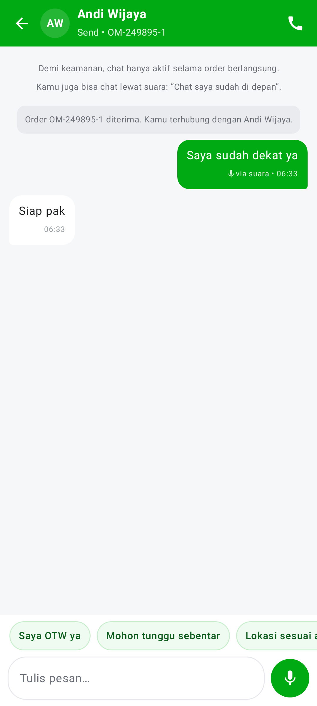
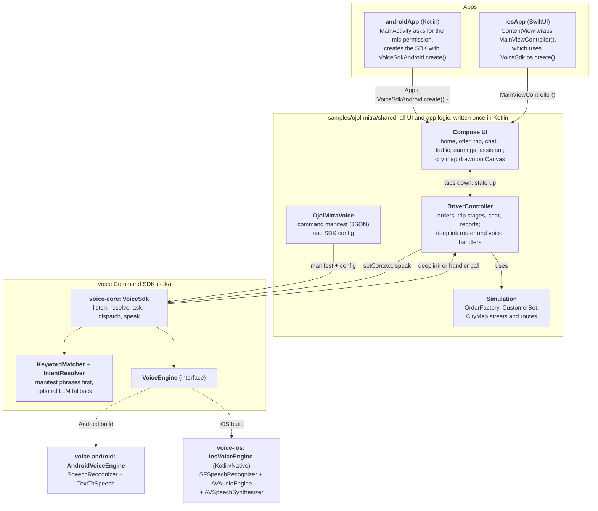
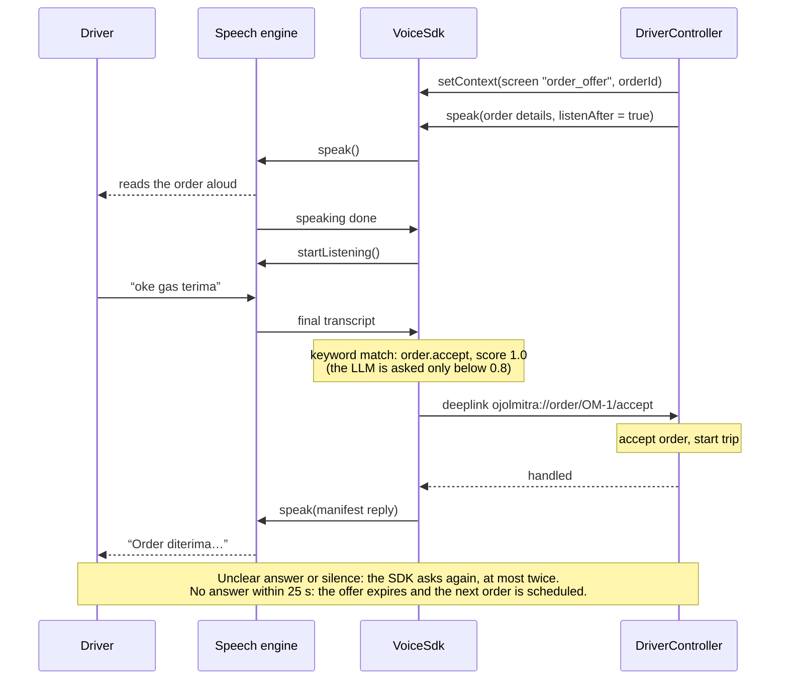
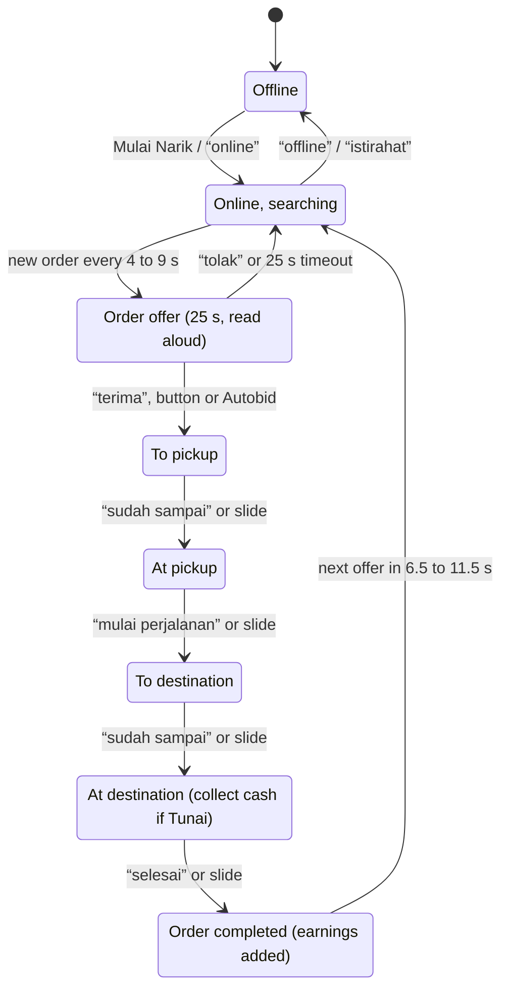

# asbun-sdk

This repository holds two things:

- **[Voice Command SDK](sdk/README.md)** (`sdk/`): a Kotlin Multiplatform library that turns speech into app actions on Android and iOS. An app lists its commands in a JSON manifest (phrases mapped to a deeplink or a handler), tells the SDK what is on screen, and can plug in any LLM by URL and API key for phrasing the keywords miss.
- **[Ojol Mitra](#ojol-mitra-technical-guide)** (`samples/ojol-mitra/`): a ride-hailing driver app prototype, and the SDK's first consumer.

# Ojol Mitra: Technical Guide

Ojol Mitra is a Kotlin Multiplatform prototype of a ride-hailing driver app for Android and iOS. One shared Kotlin codebase holds the UI and the order simulation, voice commands run on the Voice Command SDK from this repository, and every library it uses is free and open source.

> The design is inspired by ojol (ojek online) driver apps: green theme, full-screen map, bottom-sheet order card, slide-to-confirm. It uses no third-party logos, brand names or assets. The name "Ojol Mitra", the icon, the map and all data are fictional.

| Home | Incoming order + voice | Trip | Voice panel |
|---|---|---|---|
|  |  |  |  |
| **Chat by voice** | **Traffic report by voice** | **Order completed** | **Voice assistant tab** |
|  |  |  |  |

Screenshots are generated by the Android end-to-end UI test (Robolectric + Roborazzi).

**Contents:** [Features](#features) · [Architecture](#architecture) · [Third-party libraries and cost](#third-party-libraries-and-cost) · [Platform services and running costs](#platform-services-and-running-costs) · [Voice command flow](#voice-command-flow) · [Order and trip flow](#order-and-trip-flow) · [Voice command reference](#voice-command-reference) · [How to](#how-to) · [Troubleshooting](#troubleshooting) · [Verification status and limitations](#verification-status-and-limitations) · [Voice Command SDK docs](sdk/README.md)

## Features

- **Driver simulation:** go online with "Mulai Narik"; random Ride, Food and Send orders arrive every 4 to 9 s, each with a 25 s countdown, earnings, fare, pickup and drop-off distance, customer, notes and payment method.
- **Trip:** the driver moves along the route on the map; remaining distance and ETA; slide-to-confirm for each stage (pickup, start trip, arrive, complete).
- **Chat** with a simulated customer who replies in context; simulated phone call.
- **Earnings and performance:** today's earnings, wallet (cash-order commission), acceptance, completion, rating, trip history; **Autobid** accepts orders automatically.
- **Voice commands (Indonesian):** accept or reject orders, send chat to the customer, report traffic, move through trip stages, all hands-free, through the Voice Command SDK with an optional LLM fallback. See the [voice command reference](#voice-command-reference).
- **Typing mode** in the voice panel for emulators and simulators without a microphone.

## Architecture

The app uses Kotlin Multiplatform with Compose Multiplatform. All UI and app logic (about 5,300 lines) sits in one shared module; speech lives in the SDK's platform modules, so each app only creates the SDK and shows `App()`.



Read it top down: each app only creates the SDK with its platform's engine and shows `App()`; the controller never touches speech directly. It tells the SDK what is on screen, and the SDK calls back with a deeplink or a handler call once it has understood a command.

- **State:** `DriverController` exposes two `StateFlow`s. One holds orders, trip, chat, reports and earnings; the other holds the driver's position, updated 25 times a second so only the map redraws. The voice UI combines the SDK's `state` with `VoicePanel` (panel, dictation, history).
- **Threading:** controller code, SDK callbacks and all engine callbacks run on the main thread. Coroutine `delay`s drive timers, offer countdowns and driver movement.
- **Native code:** the iOS engine is Kotlin/Native calling Apple's Speech and AVFAudio APIs directly, so the Swift side is a thin wrapper.
- **Map:** `CityMap` is a fictional street grid with shortest-path routing between intersections, drawn on a Compose Canvas instead of a map SDK.

```
.
├── sdk/
│   ├── voice-core/        VoiceSdk, CommandManifest, KeywordMatcher, IntentResolver, HttpLlmClient, Deeplinks
│   ├── voice-android/     AndroidVoiceEngine, AndroidLinkOpener, VoiceSdkAndroid
│   └── voice-ios/         IosVoiceEngine, IosLinkOpener, VoiceSdkIos
└── samples/ojol-mitra/
    ├── shared/src/
    │   ├── commonMain/kotlin/id/ojolmitra/driver/
    │   │   ├── core/      DriverController (router, voice handlers, context), DriverState, SimTiming
    │   │   ├── voice/     OjolMitraVoice (manifest, config), VoicePanel, Speech
    │   │   ├── sim/       OrderFactory, CustomerBot
    │   │   ├── map/       CityMap
    │   │   └── ui/        screens/, components/, theme/
    │   ├── iosMain/       MainViewController
    │   └── commonTest/    manifest, map and controller tests
    ├── androidApp/        MainActivity + Robolectric UI test
    └── iosApp/            Xcode project (SwiftUI wrapper)
```

## Third-party libraries and cost

Every library is free and open source, so the license cost is US$0. The app needs no API keys, SDK accounts or paid services, unless you turn on the optional LLM fallback, which your LLM provider bills per use (see [Security, privacy and cost](#security-privacy-and-cost)). Test-only libraries are not shipped in the app.

| Library | Version | Used for | Scope | License | Cost |
| --- | --- | --- | --- | --- | --- |
| Kotlin (Multiplatform plugin, Compose compiler plugin) | 2.4.21 | Language, compiler, shared Android + iOS code | App | Apache 2.0 | Free |
| Compose Multiplatform (runtime, foundation, ui) | 1.11.1 | One UI for Android and iOS | App | Apache 2.0 | Free |
| Compose Material 3 (multiplatform) | 1.9.0 | Buttons, bottom sheet, switches, navigation bar | App | Apache 2.0 | Free |
| Material Icons Extended | 1.7.3 | Icons (mic, motorbike, wallet, traffic light) | App | Apache 2.0 | Free |
| kotlinx.coroutines (core, android) | 1.11.0 | Simulation timers, driver movement, StateFlow state | App | Apache 2.0 | Free |
| AndroidX Activity Compose | 1.13.0 | Android entry point, microphone permission request | App (Android) | Apache 2.0 | Free |
| kotlinx.serialization (JSON) | 1.13.0 | Reads the manifest and config, builds LLM requests | SDK | Apache 2.0 | Free |
| Ktor client (core, Android engine, Darwin engine) | 3.6.1 | HTTP calls to the optional LLM | SDK | Apache 2.0 | Free |
| Android Gradle Plugin | 8.13.2 | Android build | Build | Apache 2.0 | Free |
| Gradle (wrapper) | 8.14.7 | Build tool | Build | Apache 2.0 | Free |
| Android SDK (platform 36, build-tools 36) | 36 | Compile target | Build | Android SDK License Agreement | Free |
| kotlin-test | 2.4.21 | Unit test assertions | Test | Apache 2.0 | Free |
| kotlinx-coroutines-test | 1.11.0 | Virtual time in controller tests | Test | Apache 2.0 | Free |
| Ktor client mock | 3.6.1 | Fake LLM server in SDK tests | Test | Apache 2.0 | Free |
| JUnit 4 | 4.13.2 | Android test runner | Test | EPL 1.0 | Free |
| Robolectric | 4.18 | Runs the Android framework on the JVM | Test | MIT | Free |
| Roborazzi | 1.79.0 | Screenshots from Robolectric tests | Test | Apache 2.0 | Free |
| AndroidX Compose UI Test | 1.11.2 | Clicks and assertions on the UI in tests | Test | Apache 2.0 | Free |

Versions are pinned in `gradle/libs.versions.toml`. Compose Multiplatform stays on 1.11.1 because 1.12 needs compileSdk 37, which AGP 8.13 does not support. For the same reason the SDK uses Ktor's Android engine (HttpURLConnection) instead of OkHttp, whose 5.x releases also need compileSdk 37.

## Platform services and running costs

Running the prototype costs nothing: speech recognition, text-to-speech and the map all use free platform features, and there is no backend. Publishing to the stores adds developer-account fees.

| Service | Platform | Used for | Cost | Limits and notes |
| --- | --- | --- | --- | --- |
| `SpeechRecognizer` (android.speech) | Android | Speech to text | Free, no API key | Google's docs say it "is likely to stream audio to remote servers" and is not meant for continuous listening. No numeric quota is published; a `TOO_MANY_REQUESTS` error exists. The on-device variant (API 31+) is not used yet. [source](https://developer.android.com/reference/android/speech/SpeechRecognizer) |
| `TextToSpeech` | Android | Assistant's spoken replies | Free | Runs on the phone's TTS engine. Without Indonesian voice data it falls back to the device language. |
| Speech framework (`SFSpeechRecognizer` + `AVAudioEngine`) | iOS | Speech to text | Free, no API key | Apple throttles requests per device and per app and caps each request at about 1 minute (approximate, not checked against Apple's page). Server-based by default; on-device mode is not forced. |
| `AVSpeechSynthesizer` | iOS | Assistant's spoken replies | Free | Runs on the device. |
| City map | Both | Map, routes, traffic markers | US$0 | Drawn with Compose Canvas: no Google Maps or MapKit, no key, no per-load billing. |
| Backend | None | Orders, customers, reports | US$0 | Everything is simulated on the device. |
| LLM fallback (optional) | Both | Phrasing the manifest's keywords miss | Per token, billed by your provider | Off unless configured; see [How to turn on the LLM fallback](#turn-on-the-llm-fallback). |

**Developer accounts (only for distribution):**

- **Apple Developer Program: US$99 per year**, needed for TestFlight and the App Store ([source](https://developer.apple.com/programs/)). A free Apple Account can still run the app on your own iPhone as a Personal Team: up to 3 devices and 3 apps per device, with provisioning that expires after 7 days ([source](https://developer.apple.com/support/compare-memberships/)).
- **Google Play Console: one-time registration fee of about US$25** (approximate; Google's fee page could not be opened). Not needed to install the APK directly on a phone.

Optional upgrades, such as a wake-word engine, are paid per usage or per seat. Check current pricing before adopting one.

## Voice command flow

Every voice command takes the same path: the platform engine turns speech into text, the SDK matches the text against the manifest commands that the current screen allows, and the app acts through a deeplink or a handler while the SDK answers aloud.



The diagram shows the hands-free case; a tap on the mic skips the first five steps and starts at `startListening()`. The context tells the SDK what is on screen: the manifest's `when` conditions allow "oke" or "ya" to accept only while an offer shows, and after "Mau kirim pesan apa?" the SDK takes the whole next sentence as the chat message.

## Order and trip flow

Every trip runs the same loop, and each step has both a voice phrase and a button.



Going offline is refused while a trip is active. Autobid accepts an offer 1.5 s after it appears. Saying "selesai" while still driving to the destination arrives and completes in one step.

## Voice command reference

Commands are spoken in Indonesian. The microphone turns on when the driver taps a mic button, or automatically in hands-free mode (new order, a question from the assistant, arrival at pickup or destination). There is no wake word yet.

| Intent | Example phrases | Works when | Result |
| --- | --- | --- | --- |
| Accept order | "terima", "ambil", "gas", "sikat"; "oke" / "ya" only while an offer shows | Offer on screen | Trip starts, driver heads to pickup |
| Reject order | "tolak", "lewati", "skip", "nggak dulu", "jangan ambil", "tidak mau" | Offer on screen | Offer closes, next offer is scheduled |
| Repeat details | "ulangi", "detail order" | Offer or trip | Reads the offer or trip status again |
| Send chat | "chat saya sudah di depan", "kirim pesan ke penumpang bahwa saya kena macet", "bilang ke customer tunggu 5 menit", "balas oke siap" | Active trip | Message sent and marked "via suara" |
| Chat in two steps | "kirim pesan" or "chat", then the message | Active trip | Assistant asks "Mau kirim pesan apa?" and listens |
| Dictate chat | Tap the mic on the chat screen, then say the message | Chat screen open | The whole sentence is sent, even "terima kasih"; "batal" cancels |
| Read / call / open chat | "baca pesan", "telepon penumpang", "buka chat" | Active trip | Reads last message, simulated call, opens chat |
| Report traffic | "lapor macet parah di Jalan Sudirman", "ada kecelakaan di depan", "lapor banjir di Kemang Raya", "jalan ditutup dekat Stasiun Dukuh Atas", "info razia di Gatot Subroto" | Any time | Report with type, severity and location; marker on the map |
| Ask what to report | "lapor" | Any time | Assistant asks "Mau lapor apa?" |
| Trip stages | "sudah sampai", "penumpang sudah naik" / "makanan sudah diambil", "selesaikan order", "lanjut" | Active trip | Moves to the next stage |
| Navigation | "buka navigasi" | Active trip | Simulated navigation and remaining distance |
| Online / offline | "mulai narik", "online"; "offline", "istirahat" | Any time (offline is refused during a trip) | Changes driver status |
| Autobid | "nyalakan autobid", "matikan autobid" | Any time | Orders are accepted automatically or not |
| Earnings | "pendapatan hari ini" | Any time | Reads today's earnings and wallet balance |
| Help / cancel | "bantuan", "batal" | Any time | Lists commands for the current screen / stops |

Matching rules worth knowing (all set in the manifest, none in code):

- Fillers at the start or end ("halo", "mitra", "tolong", "dong", "ya", "pak") are ignored.
- Slang maps to standard words through `aliases`: "udah sampe" means "sudah sampai", "gak" means "tidak".
- A command runs only on the screens its `when` allows: "terima" with no offer showing, or "chat ..." with no trip, gets "perintah belum dikenali".
- The phrase must explain at least 80% of the sentence, so "apa ya tadi" does not accept an order, while "oke gas terima" does.
- "Terima kasih" never accepts an order (`notPhrases`), and "tidak mau" rejects.
- Location is the text after "di", "dekat", "depan", "arah" and similar words. No location, or "di depan" / "di sini", means the road the driver is on.
- Severity: "parah", "total" or "banget" mean Parah; "ringan" or "sedikit" mean Ringan; otherwise Sedang.
- After a question (a new order, "Mau lapor apa?"), an unclear answer or silence is re-prompted up to 2 times.

## How to

### Prerequisites

- JDK 17 to 24. The project's Gradle 8.14 does not run on JDK 25 or newer. If your only JDK is newer, for example the one bundled with Android Studio, install JDK 21 (`brew install --cask temurin@21`).
- Android Studio, recent release, with Android SDK platform 36.
- For iOS: a Mac with Apple Silicon and Xcode 16 or newer. Intel Mac simulators are not supported, because Compose Multiplatform 1.11+ dropped the `iosX64` target.

### Run on Android

1. Clone this repo and open the folder in Android Studio. This also creates `local.properties` with your SDK path.
2. Pick the `androidApp` run configuration (module `samples/ojol-mitra/androidApp`) and a device, then Run. From a terminal:
   ```bash
   ./gradlew :samples:ojol-mitra:androidApp:installDebug
   ```
3. Allow the microphone when asked. On an emulator without Google speech services, tap the keyboard icon in the voice panel and type commands instead.

### Get the APK from CI

Every push that changes code runs the [Android APK workflow](.github/workflows/android-apk.yml) on GitHub Actions, which builds the debug APK. Open the run in the repository's **Actions** tab and download `ojol-mitra-debug-<commit>.apk` under **Artifacts**. Artifacts are kept for 14 days, and the workflow can also be started by hand with **Run workflow**.

### Run on iOS

1. Open the project once in Android Studio, or set `ANDROID_HOME`. The shared and SDK modules also target Android, so Gradle needs the SDK path even for iOS builds.
2. Open `samples/ojol-mitra/iosApp/iosApp.xcodeproj` in Xcode.
3. Pick an iPhone simulator and Run. The "Compile Kotlin Framework" build phase runs `samples/ojol-mitra/iosApp/build-kotlin-framework.sh`, which picks a JDK 17 to 24 and runs `./gradlew :samples:ojol-mitra:shared:embedAndSignAppleFrameworkForXcode` from the repository root for you.
4. On a real iPhone, set Signing & Capabilities > Team (a free Personal Team works) and change the bundle id `id.ojolmitra.driver` if Xcode reports it is taken.
5. Allow Microphone and Speech Recognition when asked.

### Run the tests

```bash
./gradlew :sdk:voice-core:testDebugUnitTest                         # 46 SDK unit tests
./gradlew :samples:ojol-mitra:shared:testDebugUnitTest              # 32 app tests: manifest phrases, map routing, controller flow by voice
./gradlew :samples:ojol-mitra:androidApp:testDebugUnitTest          # end-to-end UI journey on Robolectric, screenshots in samples/ojol-mitra/androidApp/screenshots/
./gradlew :samples:ojol-mitra:shared:compileKotlinIosSimulatorArm64 # type-checks the app's and the SDK's iOS Kotlin code (also works on Linux and Windows)
```

### Turn on the LLM fallback

Without an LLM, only the manifest's phrases are understood. With one, the SDK sends what the keywords miss to your LLM, which picks one of the manifest's commands; the answer is validated before anything runs.

- **Android sample:** add these keys to `local.properties` in the repository root (the file is git-ignored), then rebuild:
  ```properties
  voice.llm.baseUrl=https://api.anthropic.com
  voice.llm.protocol=ANTHROPIC_MESSAGES
  voice.llm.model=your-model-id
  voice.llm.apiKey=your-api-key
  ```
  `protocol` can also be `OPENAI_COMPATIBLE` (any `/chat/completions` gateway) or `CUSTOM_JSON` (your own `/resolve` endpoint).
- **iOS sample:** pass an `LlmConfig` to `OjolMitraVoice.config(llm = ...)` in `MainViewController.kt`.
- A key built into an app can be extracted from it. For production, point `baseUrl` at your own proxy or use `tokenProvider`, as described in [Security, privacy and cost](#security-privacy-and-cost).

### Add a voice command

1. Add an entry to `commands` in the manifest in `samples/ojol-mitra/shared/src/commonMain/kotlin/id/ojolmitra/driver/voice/OjolMitraVoice.kt`: `id`, `description` (the LLM reads it), `phrases` with `{slots}`, `when`, `params` and an `action`. Put slang spellings in `aliases`.
2. For a `deeplink` action, handle the new path in `DriverController.route()` and return true when it worked. For a `handler` action, register it in `registerVoiceHandlers()` and return `HandlerResult.success(reply)` or `HandlerResult.failure(reply)`.
3. If the command needs a value from the screen (an id, a name), add it in `syncVoiceContext()`.
4. Add phrases to `OjolMitraManifestTest.kt` and run the unit tests.
5. Optional: add an example chip to `COMMAND_GROUPS` in `VoiceScreen.kt` and to `voiceSuggestions()` in `DriverApp.kt`.

### Tune the simulation

- Timing lives in `SimTiming` (`core/DriverState.kt`): offer every 4 to 9 s, 25 s offer countdown, each trip leg at most about 18 s, customer replies after 2.5 to 4.5 s, a community traffic report every 45 to 65 s.
- Fares live in `sim/OrderFactory.kt`: Ride Rp9.000 + Rp2.500/km, Food Rp8.000 + Rp2.400/km, Send Rp10.000 + Rp2.600/km, minimum Rp10.000. The driver earns 80% of the fare, plus a Rp2.000 bonus on 25% of orders.
- Roads, places, parks and the river live in `map/CityMap.kt`.

### Change the language or swap the voice engine

- The language tag is `OjolMitraVoice.LOCALE = "id-ID"`. Manifest phrases, aliases and fillers are keyed by language (`{"id-ID": [...], "en-US": [...]}`), so another language needs its own phrase lists; `VoiceMessages.ENGLISH` covers the SDK's built-in replies.
- To use another speech service, implement the SDK's `VoiceEngine` interface and build the SDK with `VoiceSdk(config, manifest, engine, scope)` inside `App { scope -> ... }`. Deliver callbacks on the main thread, and send exactly one final event per listening session: a result, an error, or an end without result.

## Troubleshooting

Most first-run problems come from the iOS build calling Gradle, or from missing speech services or permissions on the device.

| Symptom | Cause | Fix |
| --- | --- | --- |
| Xcode build phase "Compile Kotlin Framework" fails with "SDK location not found" | The shared and SDK modules also target Android, so Gradle needs the Android SDK path | Open the project once in Android Studio, or put `sdk.dir=/Users/<you>/Library/Android/sdk` in `local.properties` at the repository root. An `ANDROID_HOME` exported in your shell profile does not reach Xcode |
| Gradle (in Terminal or Xcode) fails with `Failed command: /usr/bin/xcrun xcodebuild -version` | The Mac uses the standalone Command Line Tools instead of Xcode | `sudo xcode-select --switch /Applications/Xcode.app/Contents/Developer`, then `./gradlew --stop` and build again |
| Xcode build phase: "What went wrong:" followed only by a version such as `25.0.4` | Gradle ran on JDK 25 or newer; Gradle 8.14 runs on JDK 17 to 24 | Install JDK 21 (`brew install --cask temurin@21`). The build script prefers a registered JDK 21 over a newer `JAVA_HOME` or Android Studio JDK |
| Xcode build phase: "No JDK 17 to 24 found" or "Unable to locate a Java Runtime" | Xcode's shell does not inherit `JAVA_HOME`, and the script found no JDK 17 to 24 | Install JDK 21, or add a User-Defined build setting `JAVA_HOME` pointing to a JDK 17 to 24. The script also checks JDKs registered with macOS (`/usr/libexec/java_home`), Homebrew's `openjdk@21` and `openjdk@17`, and Android Studio's bundled JDK |
| Xcode: "Sandbox: deny file-read" during the Kotlin build phase | User script sandboxing is on | Keep `ENABLE_USER_SCRIPT_SANDBOXING = NO` (already set in the project) |
| Link error: undefined symbol `SFSpeechRecognizer` or `AVSpeechSynthesizer` | Speech or AVFoundation not linked | Keep `-framework Speech -framework AVFoundation` in Other Linker Flags (already set) |
| iOS app stops at launch with a message about `CADisableMinimumFrameDurationOnPhone` | Compose Multiplatform checks this Info.plist key | Keep the key in `samples/ojol-mitra/iosApp/iosApp/Info.plist` if you replace that file |
| Voice panel says speech recognition is not available | Emulator or phone has no speech service (common on Android emulators without Google apps) | Use a phone with the Google app, or type commands via the keyboard icon |
| Mic button does nothing or a permission message appears | Microphone (and on iOS, Speech Recognition) permission was denied | Allow them in the system Settings for Ojol Mitra |
| Assistant speaks with a foreign accent | No Indonesian TTS voice installed | Android: Settings > Text-to-speech > install Indonesian. iOS: Settings > Accessibility > Spoken Content > Voices > Indonesian |
| Android build: dependency "requires compileSdk 37" | Compose Multiplatform was upgraded to 1.12+, or Ktor's OkHttp engine was added | Stay on Compose 1.11.x and Ktor's Android engine, or move to AGP 9 with compileSdk 37 |
| Assistant answers "perintah tidak bisa dijalankan" | The deeplink's scheme is not in `dispatch.allowedSchemes`, the router returned false, or no handler is registered for the command | Add the scheme to the allowlist, return true from `onDeeplink` when handled, and register every handler named in the manifest |
| Assistant answers "perintah belum dikenali" to a listed phrase | The command's `when` does not match the context, or the phrase covers less than 80% of the sentence | Check `syncVoiceContext()` and add the phrasing to the manifest |
| No iOS simulator target on an Intel Mac | `iosX64` is not built | Use an Apple Silicon Mac or a real iPhone |
| iOS stops listening too early or too late | Silence detection ends a request 1.3 s after the last new word (7 s with no speech) | Tune `dialog.endOfSpeechMs` and `dialog.listenTimeoutMs` in `VoiceConfig` |

## Verification status and limitations

The SDK, the Android build and all shared logic are tested. The iOS Kotlin code compiles, but the iOS app and the XCFramework have not yet been linked or launched, because that needs a Mac with Xcode.

| Check | Result | How it was checked |
| --- | --- | --- |
| SDK unit tests (46) | Pass | `./gradlew :sdk:voice-core:testDebugUnitTest` |
| App unit tests (32) | Pass | `./gradlew :samples:ojol-mitra:shared:testDebugUnitTest` |
| Android debug APK | Pass | `./gradlew :samples:ojol-mitra:androidApp:assembleDebug` (about 20 MB) |
| Android end-to-end UI journey | Pass | Robolectric + Roborazzi, through the SDK: online, offer, accept by voice, chat by voice, traffic report by voice and by form, trip stages, completion, other tabs |
| iOS Kotlin compile (SDK and app; iosArm64, iosSimulatorArm64) | Pass | Kotlin 2.4 compiler, including the Speech, AVFAudio and UIKit calls |
| LLM fallback against a real provider | Not verified | All three protocols are tested against a mock server; no real key was used |
| Xcode project file | Structure valid | Parsed with a pbxproj parser; all references resolve. Not opened in Xcode |
| iOS link, launch and speech on device | Not verified | Needs a Mac with Xcode |
| Real microphone recognition on Android | Not verified | Tests inject transcripts; no emulator was available |

Limitations of the prototype:

- Orders, customers, chat replies and other drivers' reports are simulated on the device. There is no backend, login or payment.
- The map is a fictional street grid, not GPS or real roads. Calls and navigation are simulated.
- There is no wake word. Google's docs say `SpeechRecognizer` is not meant for continuous listening, so a wake word needs a dedicated engine.
- Without an LLM configured, phrasing outside the manifest gets "perintah belum dikenali" (command not recognized).
- State is not saved: earnings and history reset when the app restarts.

Suggested next steps: run on a Mac and real phones; add a wake word; switch to on-device recognition (Android API 31+, iOS on-device mode) for offline use; replace the simulation with real maps and a backend.

## Voice Command SDK

Integration guide, manifest format, public API, and design: **[sdk/README.md](sdk/README.md)**.
