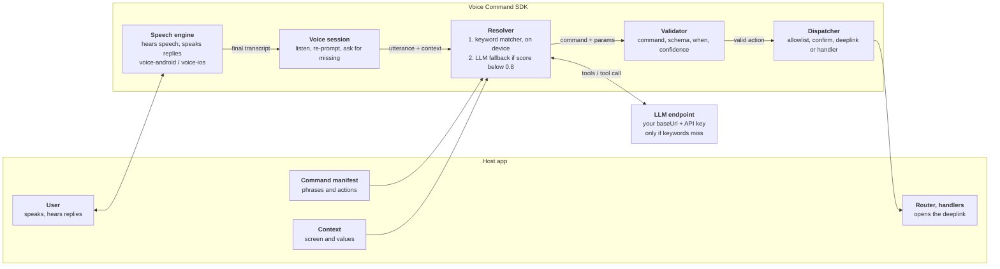
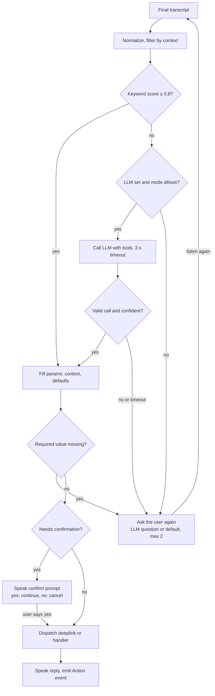

# Voice Command SDK

Kotlin Multiplatform library that turns speech into app actions on Android and iOS. An app lists its commands in a JSON manifest (phrases mapped to a deeplink or a handler), tells the SDK what is on screen, and can plug in any LLM by URL and API key for phrasing the keywords miss.

Sample consumer: [Ojol Mitra](../README.md#ojol-mitra-technical-guide) in `samples/ojol-mitra/`.

**Contents:** [Modules](#modules) · [Quick start](#quick-start) · [Manifest permissions](#manifest-permissions) · [Build and test](#build-and-test-the-sdk) · [Design and reference](#design-and-reference)

Version 1 of the [design and reference](#design-and-reference) is implemented: manifest, on-device keyword matcher, LLM fallback over three protocols, validation, context, deeplink allowlist, confirmation, slot filling, handlers, and the Android and iOS speech engines. Not done yet: publishing to Maven and Swift Package Manager, and a run on a Mac (the iOS code compiles, but has not been linked or launched).

## Modules

| Module | Contents |
| --- | --- |
| `sdk/voice-core` | `VoiceSdk` (listen, resolve, ask, dispatch, speak), `CommandManifest`, `KeywordMatcher`, `IntentResolver`, `HttpLlmClient`, `Deeplinks`, and the `VoiceEngine` interface. Kotlin Multiplatform: Android and iOS. |
| `sdk/voice-android` | `AndroidVoiceEngine` (SpeechRecognizer + TextToSpeech), `AndroidLinkOpener`, `VoiceSdkAndroid.create(...)`. Declares `RECORD_AUDIO`. |
| `sdk/voice-ios` | `IosVoiceEngine` (SFSpeechRecognizer + AVAudioEngine + AVSpeechSynthesizer), `IosLinkOpener`, `VoiceSdkIos.create(...)`. Builds `VoiceSdk.xcframework`. |

## Quick start

1. List your commands in a manifest. The full format is under [Command manifest](#command-manifest).

   ```json
   {
     "version": 1,
     "defaultLocale": "id-ID",
     "commands": [
       {
         "id": "order.accept",
         "description": "Accept the incoming order shown on screen.",
         "phrases": ["terima", "ambil", "gas"],
         "when": { "screen": "order_offer" },
         "params": [ { "name": "orderId", "from": "context", "required": true } ],
         "action": { "type": "deeplink", "url": "myapp://order/{orderId}/accept" },
         "reply": "Order diterima."
       }
     ]
   }
   ```

2. Create the SDK, route its deeplinks, tell it what is on screen, and listen. Android is shown; on iOS, call `VoiceSdkIos.create(config, manifest)` instead.

   ```kotlin
   val voice = VoiceSdkAndroid.create(
       context = this,
       config = VoiceConfig(
           locale = "id-ID",
           dispatch = DispatchConfig(allowedSchemes = listOf("myapp")),
           // Optional LLM for free-form phrasing; leave it out to stay fully on-device.
           llm = LlmConfig(baseUrl = "https://llm-proxy.example.com", model = "your-model-id", tokenProvider = { api.voiceToken() }),
       ),
       manifest = CommandManifest.fromJson(assets.open("voice-commands.json").bufferedReader().readText()),
       requestPermission = { micPermission.launch(Manifest.permission.RECORD_AUDIO) },
   )
   voice.onDeeplink { url -> router.open(url); true }   // true = handled in the app
   voice.setContext(VoiceContext(screen = "order_offer", values = mapOf("orderId" to "OM-1")))
   micButton.setOnClickListener { voice.startListening() }
   ```

3. Draw your voice UI from `voice.state` (a `StateFlow`) and `voice.events`, or from `voice.addEventListener { }`, which calls back synchronously and is the easiest option from Swift. Call `voice.close()` when you are done; it releases the microphone and text-to-speech.

The Ojol Mitra sample uses every feature: [`OjolMitraVoice.kt`](../samples/ojol-mitra/shared/src/commonMain/kotlin/id/ojolmitra/driver/voice/OjolMitraVoice.kt) holds its 23-command manifest, and [`DriverController.kt`](../samples/ojol-mitra/shared/src/commonMain/kotlin/id/ojolmitra/driver/core/DriverController.kt) its deeplink router, handlers and context.

## Manifest permissions

Speech recognition needs the microphone (and on iOS, Speech Recognition). Without these entries the OS blocks listening or rejects the app at review.

**Android** — `sdk/voice-android` already merges these into your app's `AndroidManifest.xml`. You still must request `RECORD_AUDIO` at runtime (see `requestPermission` in the quick start). Copy them only if you are not depending on the AAR's merge, or if you want them visible in your own manifest:

```xml
<!-- Microphone for SpeechRecognizer -->
<uses-permission android:name="android.permission.RECORD_AUDIO" />

<!-- Optional: LLM fallback over HTTPS -->
<uses-permission android:name="android.permission.INTERNET" />

<!-- Android 11+: so SpeechRecognizer and TextToSpeech services are visible -->
<queries>
    <intent>
        <action android:name="android.speech.RecognitionService" />
    </intent>
    <intent>
        <action android:name="android.intent.action.TTS_SERVICE" />
    </intent>
</queries>
```

**iOS** — add both usage strings to your app's `Info.plist`. Apple requires a clear purpose string; the store rejects empty or generic copy:

```xml
<key>NSMicrophoneUsageDescription</key>
<string>Microphone is used for voice commands in the app.</string>
<key>NSSpeechRecognitionUsageDescription</key>
<string>Speech recognition turns your speech into in-app commands.</string>
```

On first listen, iOS prompts for Microphone and Speech Recognition. If the user denies either, the engine reports `PERMISSION_DENIED`.

## Build and test the SDK

```bash
./gradlew :sdk:voice-core:testDebugUnitTest            # 46 unit tests: manifest, matcher, deeplinks, LLM protocols on a mock server, resolver, dialog
./gradlew :sdk:voice-android:assembleRelease           # Android library (AAR)
./gradlew :sdk:voice-ios:compileKotlinIosArm64         # type-checks the iOS engine; works on Linux and Windows too
./gradlew :sdk:voice-ios:assembleVoiceSdkXCFramework   # VoiceSdk.xcframework; needs a Mac with Xcode
```


## Design and reference

The Voice Command SDK is a Kotlin Multiplatform library that any Android or iOS app can embed to turn speech into actions. It listens, matches the words to commands the app registered, asks an LLM you configure (URL + API key) when keywords are not enough, and opens the matching deeplink or calls the app's handler. The Ojol Mitra prototype in this repo is its first consumer.

> **Status:** version 1 is implemented. The sections below are the design it follows, updated where the build differed.

### Goals and non-goals

Version 1 turns the Ojol Mitra voice layer into a product any app can configure without code changes to the SDK.

**Goals**

1. **One SDK, any app:** a Kotlin Multiplatform core with thin Android (AAR) and iOS (XCFramework) layers, usable from plain Kotlin/Java and Swift apps, not only KMP apps.
2. **Command manifest:** each app registers its commands as data: phrases per language, parameters, when the command is allowed (context), and what it triggers (a deeplink template or a named handler).
3. **Bring your own LLM:** the app sets an LLM base URL, an API key (or a token provider) and a model. The LLM maps free-form speech to one manifest command and its parameters through function calling.
4. **Works without the LLM:** keyword matching runs on the device first, so known phrases work offline and cost nothing.
5. **Safe actions:** every LLM answer is validated against the manifest; deeplinks must match an allowlist; sensitive commands ask for spoken confirmation.
6. **Conversation building blocks:** ask-and-listen, re-prompt on silence, and slot filling ("Mau kirim pesan apa?") as in the prototype.
7. **Swappable speech:** platform speech-to-text and text-to-speech by default, replaceable through the `VoiceEngine` interface.

**Non-goals for v1**

- No wake word and no own speech model (planned for a later phase).
- No hosted backend: the app owner provides the LLM endpoint or a proxy.
- No UI: the SDK emits events and the app draws its own voice panel. The Ojol Mitra panel can serve as a sample.
- No analytics collection by the SDK.

**Targets (proposed):** integration in under a day with a manifest and about 10 lines of code; keyword commands act within 300 ms of the final transcript; LLM fallback answers within 2.5 s at p95.

### SDK architecture

Every utterance runs down one pipeline inside the SDK; the host app only supplies the manifest, the context and a router, and the LLM is called only when keywords cannot decide.



The speech engines and the voice session came out of the prototype; the resolver, the LLM client and the validator are new.

### Configuration

An app configures the SDK with one `VoiceConfig`, built in code or loaded from JSON. Leaving out the LLM block keeps the SDK fully on-device.

| Setting | Type | Default | Purpose |
| --- | --- | --- | --- |
| `llm.baseUrl` | URL | not set (LLM off) | Endpoint root, e.g. `https://llm-proxy.example.com/v1` |
| `llm.tokenProvider` | suspend function returning a string | not set | Fetches a short-lived token from the app's backend before each call; preferred way to authenticate |
| `llm.apiKey` | string | not set | Static key, for development and internal builds only |
| `llm.authHeader` | string | `Authorization: Bearer` | Header and prefix for the key, e.g. `x-api-key` |
| `llm.protocol` | enum | `OPENAI_COMPATIBLE` | `OPENAI_COMPATIBLE`, `ANTHROPIC_MESSAGES` or `CUSTOM_JSON` (see LLM contract) |
| `llm.model` | string | not set | Model id sent in each request |
| `llm.timeoutMs` | int | 3000 | After this, fall back to the keyword result or ask the user to repeat |
| `llm.extraHeaders` | map | empty | Extra headers, e.g. an API version |
| `locale` | BCP 47 tag | `id-ID` | Speech and matching language, e.g. `id-ID` |
| `resolution.mode` | enum | `KEYWORD_FIRST` | `KEYWORD_FIRST`, `LLM_FIRST`, `KEYWORD_ONLY` or `LLM_ONLY` |
| `resolution.keywordMinScore` | 0 to 1 | 0.8 | Keyword matches below this go to the LLM |
| `resolution.llmMinConfidence` | 0 to 1 | 0.6 | LLM answers below this make the assistant ask again |
| `dialog.maxReprompts` | int | 2 | Re-asks after silence or an unclear answer |
| `dialog.listenTimeoutMs` | int | 7000 | No speech for this long ends listening |
| `dialog.endOfSpeechMs` | int | 1300 | Silence after the last word that ends a request |
| `tts.enabled` | bool | true | Speak replies aloud |
| `dispatch.allowedSchemes`, `dispatch.allowedHosts` | lists | the app's own scheme | Deeplink allowlist |
| `privacy.sendContextToLlm` | bool | true | Off = the LLM gets the transcript and command list only |
| `privacy.redactor` | function | not set | Strips personal data from the transcript before an LLM call |
| `logging.level` | enum | `NONE` | `NONE`, `ERROR` or `DEBUG` (DEBUG never logs keys) |

The same settings as JSON, for remote config. The API key is deliberately absent: it comes from `tokenProvider` at runtime.

```json
{
  "locale": "id-ID",
  "llm": {
    "baseUrl": "https://llm-proxy.example.com/v1",
    "protocol": "OPENAI_COMPATIBLE",
    "model": "your-model-id",
    "timeoutMs": 3000
  },
  "resolution": { "mode": "KEYWORD_FIRST", "keywordMinScore": 0.8, "llmMinConfidence": 0.6 },
  "dispatch": { "allowedSchemes": ["ojolmitra"] }
}
```

### Command manifest

The manifest maps spoken phrases to a function, the context where it is allowed, and the deeplink or handler it fires. Apps ship it as JSON (bundled or fetched), so new commands need no SDK release.

| Field | Required | Meaning |
| --- | --- | --- |
| `id` | Yes | Unique name, e.g. `order.accept`; also the function name the LLM calls |
| `description` | Yes | One sentence for the LLM: what the command does and when to use it |
| `phrases` | Yes | Per-language trigger phrases; `{slot}` marks a parameter, e.g. `"chat {message}"` |
| `notPhrases` | No | Phrases that must never trigger it, e.g. "terima kasih" for `order.accept` |
| `when` | No | Context conditions, e.g. `{"screen": "order_offer"}`; the command is ignored elsewhere |
| `params` | No | Parameters: `name`, `type` (`text`, `enum`, `number`, `date`), `from` (`speech`, `context` or `both`), `required`, enum `values` with synonyms, `default`, `ask` (question when missing), and `after` (words that start a text value outside the phrase, e.g. `["di", "dekat"]` for a place) |
| `action` | Yes | `{"type": "deeplink", "url": "app://...{param}"}` or `{"type": "handler", "name": "..."}` |
| `confirm` | No | Spoken confirmation before acting, for destructive commands |
| `reply` | No | Spoken reply template; a handler can override it |
| `priority` | No | Tie-breaker when two commands match equally |

Top-level keys: `version`, `app`, `defaultLocale`, `aliases` (slang per language, e.g. "udah" to "sudah"), `fillers` (words to ignore, e.g. "tolong", "dong") and `suffixes` (endings to strip from known words, e.g. "-nya").

Example for Ojol Mitra (three of its commands; the full manifest is in `OjolMitraVoice.kt`):

```json
{
  "version": 1,
  "app": "ojolmitra-driver",
  "defaultLocale": "id-ID",
  "aliases": { "id-ID": { "udah": "sudah", "sampe": "sampai", "gak": "tidak" } },
  "fillers": { "id-ID": ["halo", "tolong", "dong", "ya", "pak"] },
  "commands": [
    {
      "id": "order.accept",
      "description": "Accept the incoming order shown on screen.",
      "phrases": { "id-ID": ["terima", "terima order", "ambil", "gas", "oke", "ya"] },
      "notPhrases": { "id-ID": ["terima kasih"] },
      "when": { "screen": "order_offer" },
      "params": [ { "name": "orderId", "type": "text", "from": "context", "required": true } ],
      "action": { "type": "deeplink", "url": "ojolmitra://order/{orderId}/accept" },
      "reply": { "id-ID": "Order diterima." }
    },
    {
      "id": "chat.send",
      "description": "Send a chat message to the customer of the active trip.",
      "phrases": { "id-ID": ["chat {message}", "kirim pesan ke penumpang {message}", "bilang ke customer {message}"] },
      "when": { "screen": ["trip", "chat"] },
      "params": [
        { "name": "message", "type": "text", "from": "speech", "required": true,
          "ask": { "id-ID": "Mau kirim pesan apa?" } },
        { "name": "tripId", "type": "text", "from": "context", "required": true }
      ],
      "action": { "type": "deeplink", "url": "ojolmitra://trip/{tripId}/chat?text={message}" },
      "reply": { "id-ID": "Pesan terkirim." }
    },
    {
      "id": "traffic.report",
      "description": "Report a traffic condition (jam, accident, flood) at a place.",
      "phrases": { "id-ID": ["lapor {type} di {location}", "lapor {type}", "ada {type} di {location}"] },
      "params": [
        { "name": "type", "type": "enum", "from": "speech", "required": true,
          "values": { "MACET": ["macet", "padat"], "KECELAKAAN": ["kecelakaan", "tabrakan"], "BANJIR": ["banjir", "genangan"] },
          "ask": { "id-ID": "Mau lapor apa? Macet, kecelakaan, atau banjir?" } },
        { "name": "severity", "type": "enum", "from": "speech", "default": "SEDANG",
          "values": { "PARAH": ["parah", "total"], "RINGAN": ["ringan", "sedikit"] } },
        { "name": "location", "type": "text", "from": "both", "default": "{context.currentRoad}" }
      ],
      "action": { "type": "handler", "name": "reportTraffic" },
      "reply": { "id-ID": "Laporan {type} di {location} terkirim." }
    }
  ]
}
```

Keyword matching rules, generalized from the prototype's parser:

1. Normalize the transcript: lowercase, drop punctuation, apply `aliases`, strip `suffixes` from known words, drop leading and trailing `fillers`.
2. Drop commands whose `when` does not hold, and any command whose `notPhrases` match.
3. Match `phrases`: literal words must appear in order; a trailing `text` slot takes the remaining words, a middle one the fewest that let the rest match, and an `enum` slot must hit one of its synonyms. A trailing slot may stay empty, so "chat" alone leads to "Mau kirim pesan apa?".
4. Extract the other parameters: enum synonyms anywhere in the sentence, and `text` values after their `after` words, up to the next enum synonym.
5. Score how much of the sentence the match explains: 1.0 × coverage for word-only phrases, 0.9 × coverage when slots or extracted values are involved, minus 0.1 per one-letter typo (words of five or more letters). Other word-only phrases of the same command, and more synonyms of a matched enum value, count as explained ("gas, terima", "macet padat"). Ties go to `priority`, then the phrase with more literal words.
6. Fill `from: context` parameters from the current context, apply `default`s, and ask for any missing `required` parameter with its `ask` prompt.

### Intent resolution flow

In the default `KEYWORD_FIRST` mode the device settles known phrases on its own, and the LLM runs only on a miss; whatever it returns passes the same validation before anything is opened.



Every "ask" path speaks a question and listens again, at most `dialog.maxReprompts` times (2 by default). `LLM_FIRST` swaps the first two checks, `KEYWORD_ONLY` never calls the LLM, and `LLM_ONLY` skips keyword matching.

### LLM contract

The SDK turns the manifest into LLM tools (one function per command) and sends one request per unresolved utterance; the LLM answers with at most one tool call, which the SDK validates before acting. The client is raw HTTP over Ktor, because no official LLM SDK runs on iOS through Kotlin/Native.

**Tool generation:** each command becomes a function named after its `id` with dots replaced by underscores (`order.accept` becomes `order_accept`), since function names allow only letters, digits, `_` and `-`, up to 64 characters. Its `description` is copied, and its `speech` and `both` parameters become a JSON Schema. Parameters filled from context are left out, so the LLM cannot invent an order id. Every schema also gets a reserved `confidence` number (0 to 1).

**System prompt (template):**

```text
You map one spoken request from a mobile app user to exactly one app command.
Language: {locale}. Current screen and data: {contextJson}.
Call the single matching tool, with parameter values taken from the transcript.
Set confidence to how sure you are.
If nothing matches or the request is ambiguous, call no tool and reply with one
short question in {locale}.
```

**`ANTHROPIC_MESSAGES`** (POST `{baseUrl}/v1/messages`; headers `x-api-key`, `anthropic-version: 2026-10-21`, `content-type: application/json`):

```json
{
  "model": "<model id>",
  "max_tokens": 256,
  "output_config": { "effort": "low" },
  "system": "<system prompt above>",
  "tools": [
    {
      "name": "chat_send",
      "description": "Send a chat message to the customer of the active trip.",
      "strict": true,
      "input_schema": {
        "type": "object",
        "properties": {
          "message": { "type": "string" },
          "confidence": { "type": "number" }
        },
        "required": ["message", "confidence"],
        "additionalProperties": false
      }
    }
  ],
  "tool_choice": { "type": "auto", "disable_parallel_tool_use": true },
  "messages": [ { "role": "user", "content": "bilang ke penumpang saya kejebak macet" } ]
}
```

The answer is a `tool_use` content block (`stop_reason: "tool_use"`) with `name` and `input`, or a text block holding the clarifying question. A `stop_reason` of `refusal` is treated as no match. Forced `tool_choice` (`any` or a named tool) is rejected by current models, so the SDK always sends `auto`, and `disable_parallel_tool_use` keeps it to one call. `strict: true` makes the arguments match the schema exactly. The request sends no `temperature`, which API version `2026-10-21` rejects.

**`OPENAI_COMPATIBLE`** (POST `{baseUrl}/chat/completions`; header `Authorization: Bearer <key>`), the shape most gateways and self-hosted servers accept:

```json
{
  "model": "<model id>",
  "messages": [
    { "role": "system", "content": "<system prompt above>" },
    { "role": "user", "content": "bilang ke penumpang saya kejebak macet" }
  ],
  "tools": [ { "type": "function", "function": { "name": "chat_send", "description": "...", "parameters": { "...": "same JSON Schema" } } } ],
  "tool_choice": "auto"
}
```

The answer is `choices[0].message.tool_calls[0].function` with `name` and `arguments` (a JSON string), or `choices[0].message.content` holding the question.

**`CUSTOM_JSON`** for a backend the app owner writes (POST `{baseUrl}/resolve`):

```json
{ "transcript": "...", "locale": "id-ID", "context": { "screen": "trip" },
  "commands": [ { "id": "chat.send", "description": "...", "params": { "...": "JSON Schema" } } ] }
```

Response: `{ "commandId": "chat.send" | null, "params": { "message": "..." }, "confidence": 0.92, "question": null }`.

**Validation after any protocol:** the command must exist and pass its `when`; parameters must match the schema and enum values; confidence must reach `llmMinConfidence`. Anything else is a no-match: the SDK speaks the LLM's question if there is one, otherwise the default "not understood" reply. Set `max_tokens` around 256 because the answer is one short call, and keep the system prompt and tool list byte-stable so prompt caching can apply.

### Context and deeplink dispatch

The app tells the SDK what is on screen through a context object; the SDK uses it to filter commands, fill parameters and build deeplinks, so the same phrase can do different things on different screens.

```kotlin
voice.setContext(
    VoiceContext(
        screen = "trip",
        values = mapOf("tripId" to "OM-482193", "customerName" to "Rina", "currentRoad" to "Jl. Jend. Sudirman"),
    )
)
```

- Values are strings, numbers or booleans, at most 2 KB in total.
- `when` conditions read them: `{"screen": ["trip", "chat"]}` matches either screen, and `{"hasOffer": true}` matches a boolean. All listed keys must match.
- Parameters with `from: context` take the value of the same name; `{context.key}` works inside `default`, `reply` and URLs.
- The context goes to the LLM unless `privacy.sendContextToLlm` is off.

**Template filling:** `{param}` and `{context.key}` placeholders are replaced and percent-encoded (path segments and query values separately). If a required value is still missing, the SDK asks with the parameter's `ask` prompt instead of opening a broken link.

**Dispatch rules:**

1. Check the final URL against `dispatch.allowedSchemes` and `dispatch.allowedHosts`. Anything else is dropped and reported as an error event, never opened.
2. If the command has `confirm`, speak the prompt and listen for yes or no. Built-in words for `id-ID`: "ya", "iya", "oke", "lanjut" versus "tidak", "batal", "jangan".
3. Hand an in-app deeplink to the app's `onDeeplink` callback, which routes it with the app's own router without leaving the app.
4. Only when no callback is set, or the link targets another app, open it with the system: `Intent.ACTION_VIEW` on Android, `UIApplication.open` on iOS.
5. For `handler` actions, call the registered handler. It returns success or failure and may replace the spoken reply.
6. Speak the `reply` template, or the handler's reply, and emit an `onAction` event with the command id, parameters and outcome.

One utterance fires at most one action, and a repeat of the same command within 1 s is ignored, so an echo of the assistant's own voice cannot trigger it twice.

### Public API

The app creates one `VoiceSdk` instance, gives it a config and a manifest, wires two callbacks, and starts listening; everything else comes back as events.

| Call | Purpose |
| --- | --- |
| `VoiceSdkAndroid.create(context, config, manifest)`, `VoiceSdkIos.create(config, manifest)` | Build the instance with the platform's speech engine; `VoiceSdk(config, manifest, engine, scope)` takes any engine |
| `updateManifest(manifest)` | Swap commands at runtime, e.g. after a remote config fetch |
| `setContext(context)` | Current screen and values |
| `startListening()`, `stopListening()`, `cancelListening()`, `cancel()` | Mic button behaviour; `stopListening` asks for the final result now, `cancel` also drops questions and queued speech |
| `speak(text, listenAfter, interrupt)` | Say something, then optionally listen (hands-free prompts) |
| `submitText(text)` | Resolve typed text as if spoken: emulators, accessibility, tests |
| `onDeeplink(callback)` | Route allowed in-app deeplinks with the app's router; return true when handled |
| `registerHandler(name, handler)` | Implement `handler` actions; returns success or failure, an optional reply, and whether to listen again |
| `state`, `events`, `addEventListener(listener)` | `StateFlow<VoiceState>`, `Flow<VoiceEvent>`, and synchronous callbacks (easiest from Swift) |
| `close()` | Stop everything and release the speech engine |

Events: `StateChanged` (idle, listening, processing, speaking), `SoundLevel`, `Partial`, `Final`, `Resolved` (command id, parameters, source `KEYWORD` or `LLM`, confidence), `NeedsInput` (parameter and question), `NoMatch`, `Cancelled`, `Action` (command id and outcome) and `Error`. Error codes: `PERMISSION_DENIED`, `STT_UNAVAILABLE`, `NO_MATCH`, `LLM_TIMEOUT`, `LLM_HTTP_ERROR`, `LLM_INVALID_RESPONSE`, `DEEPLINK_BLOCKED`, `HANDLER_FAILED`.

Android (Kotlin):

```kotlin
val voice = VoiceSdkAndroid.create(
    context = applicationContext,
    config = VoiceConfig(
        locale = "id-ID",
        llm = LlmConfig(
            baseUrl = "https://llm-proxy.example.com",
            protocol = LlmProtocol.ANTHROPIC_MESSAGES,
            model = "your-model-id",
            tokenProvider = { authApi.fetchVoiceToken() },
        ),
        dispatch = DispatchConfig(allowedSchemes = listOf("ojolmitra")),
    ),
    manifest = CommandManifest.fromJson(assets.open("voice-commands.json").bufferedReader().readText()),
)
voice.onDeeplink { uri -> navController.navigate(uri); true }
voice.registerHandler("reportTraffic") { call ->
    trafficRepository.report(call.param("type"), call.param("severity"), call.param("location"))
    HandlerResult.success()
}
micButton.setOnClickListener { voice.startListening() }
```

iOS (Swift). Not yet compiled against Swift, because that needs a Mac; the names follow Kotlin/Native's Objective-C export:

```swift
let voice = VoiceSdkIos.shared.create(config: config, manifest: manifest)
voice.onDeeplink(handler: router)                                  // router adopts the DeeplinkHandler protocol
voice.registerHandler(name: "reportTraffic", handler: trafficHandler)
voice.addEventListener(listener: panel)                            // panel adopts VoiceEventListener
voice.startListening()
```

A Kotlin Multiplatform app can call the common API directly from shared code, as the Ojol Mitra prototype does today.

### Security, privacy and cost

The provider API key must never ship inside the app, and the LLM is the only part that costs money per use.

**Security**

- **Keys:** a key bundled in an APK or IPA can be extracted. Production apps either point `baseUrl` at their own proxy, which holds the provider key and rate-limits per user, or use `tokenProvider` to fetch a short-lived token from their backend. `apiKey` is for internal builds only. Keys stay in memory and are never logged.
- **Transport:** `baseUrl` must be HTTPS. Plain HTTP is refused, except `localhost`, `127.0.0.1` and the Android emulator's host `10.0.2.2`, for local development.
- **Constrained output:** the LLM can only pick a registered tool, its arguments are schema-validated, and context-only parameters (ids) never come from the LLM. It cannot produce a URL of its own.
- **Prompt injection:** the transcript is sent as user data. Whatever it says, the worst outcome is a wrong but registered command, which the allowlist and `confirm` contain.

**Privacy**

- The SDK never stores audio. Platform speech-to-text may send audio to Google or Apple servers, so the app's privacy policy must say so.
- In `KEYWORD_FIRST` mode the LLM sees only utterances that keywords could not resolve: the transcript plus context, unless `sendContextToLlm` is off. The `redactor` hook can mask phone numbers or names first.
- The SDK sends no analytics; events stay inside the app.
- Required permissions: see [Manifest permissions](#manifest-permissions) (`RECORD_AUDIO` and speech/TTS queries on Android; `NSMicrophoneUsageDescription` and `NSSpeechRecognitionUsageDescription` on iOS).

**Cost**

Speech-to-text and text-to-speech use free platform APIs, so the running cost is the LLM: cost per call = input tokens x input price + output tokens x output price. Estimate per call (to be measured): about 2,000 input tokens (system prompt, about 15 tool definitions, context, transcript) and about 100 output tokens (one tool call).

| Model | Input US$ / 1M tokens | Output US$ / 1M tokens | Per call (estimate) | Per day at 50,000 calls |
| --- | --- | --- | --- | --- |
| Claude Opus 5.5 | 4.00 | 20.00 | 0.0100 | 500.00 |
| Claude Sonnet 5.5 | 2.00 | 10.00 | 0.0050 | 250.00 |
| Claude Haiku 5.5 | 0.10 | 0.50 | 0.00025 | 12.50 |

Anthropic list prices as of 2026-11-03 ([pricing](https://platform.claude.com/docs/en/about-claude/pricing)); other providers differ. 50,000 calls a day is, for example, 1,000 drivers each making 250 utterances, of which 20% reach the LLM. Three levers cut the bill without code changes: `KEYWORD_FIRST` keeps routine phrases off the LLM; prompt caching of the stable system prompt and tool list bills those tokens at the cached-read rate (US$0.20 per 1M instead of US$4.00 on Opus 5.5); and `effort: low` keeps thinking tokens, which bill as output, small.

### Packaging and rollout

The SDK ships as three modules from this repository, and the Ojol Mitra prototype becomes its first consumer and sample app.

| Module | Contents | Artifact |
| --- | --- | --- |
| `voice-core` | Manifest parser, keyword matcher, resolver, LLM clients, dispatcher logic, assistant state machine, `VoiceEngine` interface | KMP library (consumed directly by KMP apps) |
| `voice-android` | Android speech engine, `Intent` dispatch, Android API facade | AAR on Maven |
| `voice-ios` | iOS speech engine (Kotlin/Native), `UIApplication` dispatch, Swift-friendly facade | XCFramework via Swift Package Manager (binary target), optional CocoaPods |

New dependencies: kotlinx.serialization for JSON and Ktor client (Android engine on Android, Darwin engine on iOS), both Apache 2.0 and free. Supported platforms: Android 8.0+ (API 26), iOS 15+, Kotlin 2.4+. Versions follow semver, and the manifest's own `version` field lets an older SDK reject a manifest it cannot read.

Repository layout: `sdk/voice-core`, `sdk/voice-android`, `sdk/voice-ios`, and `samples/ojol-mitra` (the prototype, moved).

Phases:

1. **Extract (done):** `VoiceEngine`, the voice session and both platform engines moved out of the prototype. The hard-coded parser became the manifest in `OjolMitraVoice.kt` plus the SDK's keyword matcher, and its parser tests became manifest tests.
2. **LLM resolver (done, except a sample proxy):** the three protocols, validation, confidence and `tokenProvider`, with contract tests against a mock LLM server.
3. **Dispatch and release (dispatch done, release open):** context, deeplinks, allowlist, confirmation and handlers are in. Still to do: publish 1.0 to Maven and Swift Package Manager.
4. **Later:** wake word, on-device recognition, more languages, and an optional Compose UI module based on the prototype's voice panel.

### Open questions

These decisions change the build plan or the cost and should be settled before phase 2.

- [ ] Which LLM provider and model go to production, and who hosts the key-holding proxy?
- [ ] Default resolution mode: `KEYWORD_FIRST` (cheaper, more predictable) or `LLM_FIRST` (more flexible phrasing)?
- [ ] Which languages ship in 1.0 besides Indonesian?
- [ ] May the SDK open deeplinks into other apps, or only into the host app?
- [ ] Public distribution (Maven Central, public Swift package) or private (GitHub Packages, private repo)?
- [ ] Is a wake word required for 1.0, or is the mic button plus hands-free prompts enough?
- [ ] What consent text and retention rules apply to transcripts sent to the LLM?
